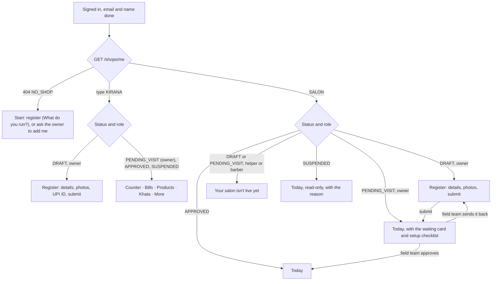
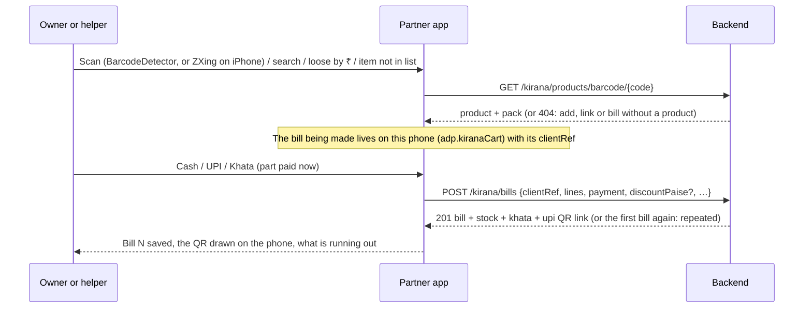
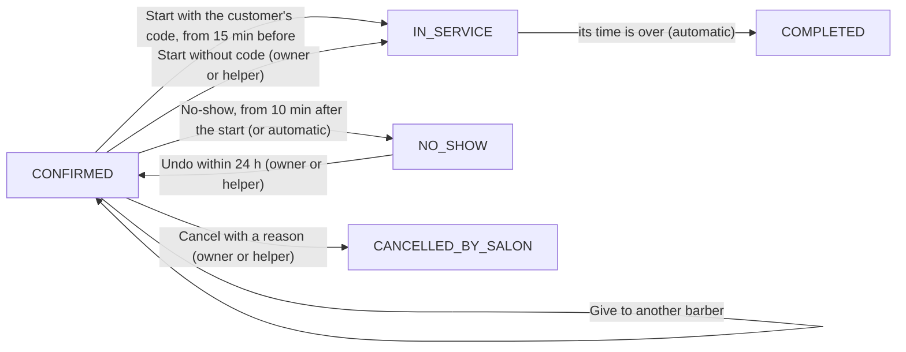

# Clozest — partner app

The app salons use to run their day on Clozest: register the salon, set up services and barbers, and work the
day's bookings and walk-ins. It is a phone-first web app (it can be added to the home screen) and talks only to
[apni-dukan-backend](https://github.com/Premanshu-jha/apni-dukan-backend).

One app for everyone in a salon, each seeing only their part:

| Role | How they get in | What they see |
| --- | --- | --- |
| Owner | Registers the salon here | Everything: setup, the day board, breaks and leave, closed days, pause, Team |
| Helper | The owner invites their number in Team; they accept | The day board and its actions, breaks, pause; setup to look at, not change |
| Barber | The owner invites his number on his barber page; he accepts | His own bookings and his own breaks (everyone's day if the owner gave him walk-in access) |

There is one app branch, `main`. As released it is for salons; the kiranas' side (grocery and general stores: the
counter, bills, products, khata) is in it too, behind the [kirana switch](#kirana-switch), off by default. With it
on, a kirana's people see only kirana screens and a salon's only salon screens. Customers use [apni-dukan-customer](https://github.com/Premanshu-jha/apni-dukan-customer);
the field team (approvals, strike support) will use the admin app.

## Run it on your laptop

You need Node 22 and the backend running (on your laptop at `http://localhost:8080`, or on Railway).

```bash
npm install
cp .env.example .env.local     # then edit the values
npm run dev                    # http://localhost:5174 (5173 is the customer app)
```

| Setting | What it is | Example |
| --- | --- | --- |
| `VITE_API_URL` | The backend's address, no trailing slash | `http://localhost:8080` or `https://apni-dukan-backend-production.up.railway.app` |
| `VITE_TURNSTILE_SITE_KEY` | Cloudflare Turnstile **site** key (public). Leave empty when the backend has no `TURNSTILE_SECRET_KEY` | `0x4AAAAAAA…` |
| `VITE_SUPPORT_EMAIL` | The support address shown under "Need help" (More, the form). Default `support@clozest.in` | `support@clozest.in` |
| `VITE_MAP_TILES` | Map tiles for the location pin. Default OpenStreetMap's, fine for low traffic (see its tile policy) | empty |

| `VITE_KIRANA_ENABLED` | The [kirana switch](#kirana-switch): `true` turns the kiranas' side on. Off when unset (anything but `true` is off) | `false` |

All are public values baked into the page at build time. No secret ever goes in this app.

### Kirana switch

`VITE_KIRANA_ENABLED` (build-time) decides whether this build serves kiranas. **Off by default**: unset, empty or
anything but `true` is off.

- **Off** (production today): the salon app, nothing of the kiranas'. Start says "I own a salon" and goes straight to
  the salon's details (no "What do you run?"); there are no kirana tabs, routes or links (an old `/kirana/...` link is
  "Page not found"); the app makes no `/kirana/...` call and never downloads a kirana screen. A shop that is a kirana
  anyway sees only "Kirana shops aren't on Clozest yet", with help and Sign out.
- **On**: the kirana partner app as it was on the `kirana-partner` branch: "What do you run?", kirana registration,
  the counter, bills, products, khata, Team, UPI ID and Licences.

To turn it on, set `VITE_KIRANA_ENABLED=true` where the app is built (`.env.local` for `npm run dev`, the host's
variables on Railway; for the Play Store app, the GitHub variable `VITE_KIRANA_ENABLED`, read by the android job) and
build again: the value is baked in, so changing it needs a new build (for the app, the android job's next run after a
merge, whose screens reach phones as a screen update). **Kirana on in the app needs the backend's `KIRANA_ENABLED`
on too**: with the backend's off, its kirana paths answer 404 `KIRANA_OFF`, and a kirana screen would only show
errors. The other way round is harmless: the backend on and the app off shows nothing of the kiranas'.

#### Kirana in the Play Store app: by branch, and the launch switch

The android job (`.github/workflows/ci.yml`) decides kirana for each build with `scripts/kirana-build.mjs`:

| The build | `VITE_KIRANA_ENABLED` (GitHub variable) not `true` | set to `true` (launch) |
|---|---|---|
| `main`, and any branch not starting with `kirana` | kirana **off** | kirana **on** |
| A branch named `kirana…` (`kirana-counter`, `kirana/setup`): a push to it, or a PR from it | kirana **on**, as a **kirana test build** | kirana **on** |

- **Testing kirana on a phone:** push your work to a branch whose name starts with `kirana` (lower case). CI builds
  on every push to such a branch, PR or not. On the run's page, under **Artifacts**, download
  `clozest-partner-android-kirana-test` (a .zip), unzip it and copy `app-debug.apk` to the phone; open it there (allow
  "Install unknown apps" for Files or Chrome when asked). The backend it talks to (`VITE_API_URL`) needs
  `KIRANA_ENABLED=true`.
- **Which app is on the phone:** a kirana test build shows a small "Kirana test build" label at the bottom left
  (`components/TestBuildMark.tsx`; taps go through it). Nothing else shows it.
- **Installing over another app:** every test APK, kirana or not, is signed with the same debug key (main's, kept in
  GitHub's cache `android-debug-keystore-v1`; other builds only read it), so a newer one installs over the last and you stay signed in. Android refuses
  one installed over the Play Store's Clozest Partner (another key), over an APK from before this change, over a newer
  run's APK (an older one is a downgrade), or after GitHub dropped the key (unused for 7 days): then uninstall the
  app first (Settings › Apps › Clozest Partner › Uninstall) and sign in again.
- **Back to the normal app:** uninstall the test APK, then install Clozest Partner from the Play Store (or the latest
  APK from a run of `main`).
- **A kirana test build takes no screen updates:** it is built without `CAPGO_PUBLIC_KEY`, so main's screens (kirana
  off) never replace its own. To see newer kirana work, install the next test APK. It is never signed for the Play
  Store (no `app-release.aab`) and never sent to phones as a screen update.
- **Nothing kirana reaches users before launch:** only builds of `main` are sent to phones, and `main` is never a
  kirana branch, so they have kirana off until the variable is `true`. Kirana code can be merged into `main` at any
  time: it stays hidden.
- **Launch:** set the backend's `KIRANA_ENABLED=true` first. Then set the GitHub variable `VITE_KIRANA_ENABLED` to
  `true` and start a **new** run of `main`: merge anything, or push an empty commit
  (`git commit --allow-empty -m "Turn kirana on"` then `git push` on `main`). Its screens, with kirana on, reach
  phones as a screen update. Don't use "Re-run" on an old run: it keeps that run's build number, which was already
  sent, so nothing new is sent. Set the Railway website's `VITE_KIRANA_ENABLED=true` the same day. Phones with a
  kirana test APK keep it until it is uninstalled.
- The website on Railway doesn't follow branches: it is built from `main` with Railway's own `VITE_KIRANA_ENABLED`.

In the code the switch is asked in a few places only: `kiranaOn()` and `shopTypeOn()` in `src/lib/config.ts`; the
kirana routes in `src/app/kiranaRoutes.tsx` (each kirana screen there is a `React.lazy` download of its own); the
bottom bar (`tabsFor` in `src/app/Shell.tsx`); the type picker (`pickedKind` in `src/features/shop/Register.tsx`,
always a salon when off, and its "Registering a … · Change" line); Start's words (`startWords`); the shop gate
(`ShopGate`, and `RegisterLayout` for a draft); and forgetting the counter's cart at sign-out. Everything else that is
a kirana's shows only for a shop of type `KIRANA`, which never gets past the gate when off.

The kiranas' words are behind the switch too (`src/i18n/kirana.ts`): `src/i18n/<language>/kirana*.json` (the
counter, bills, products, registration, and `kiranaErrors.json` / `kiranaServer.json`, the kirana error codes and
backend messages) are in neither English's main download nor a language's own. With the switch on, `main.tsx`
(`startKiranaTexts`) adds them before the language is restored: English's kirana words are one download at start-up,
and each other language's come in the same load as that language (and are kept on the phone with it, so a cold start
shows a kirana screen in the language at once). `kiranaErrors.json` adds its codes to `error` and `kiranaServer.json`
its messages to `server`, so `error.<CODE>` and `server.<message>` are asked for as before. Every kirana screen's
download also waits for them (`withKiranaTexts`), so none is drawn with keys. Off, a salon partner downloads about
14 KB (gzip) less English and about 19 KB less per other language. The core (`addAreas` and `areasReady` in
`src/i18n/index.ts`) knows nothing of kiranas; a test (`src/i18n/kiranaTexts.test.ts`) checks both ways.

Tests: `src/lib/config.test.ts` (the switch) and `src/kiranaSwitch.test.tsx` (the routes, tabs, type picker, Start and
the gate, both ways). Playwright builds the app twice: the `salon` project (the default build, switch off, port 4173)
runs every spec but `e2e/kirana-*.spec.ts`, among them `e2e/no-kirana.spec.ts` (no kirana choice, no `/kirana/...`
page, no kirana call or download); the `kirana` project (built with `VITE_KIRANA_ENABLED=true` into `dist-kirana`,
port 4174) runs only `e2e/kirana-*.spec.ts`. `npm run e2e` runs both; `--project=salon` or `--project=kirana` one.

The backend must allow this app's address in `CORS_ALLOWED_ORIGINS`: add `http://localhost:5174` for local work,
and the deployed address once it is online.

| Command | Does |
| --- | --- |
| `npm run dev` | Dev server with hot reload |
| `npm run typecheck` | TypeScript check |
| `npm run lint` | oxlint |
| `npm test` | Unit tests (Vitest) |
| `npm run e2e` | End-to-end tests (Playwright): a real browser drives the app against a fake backend |
| `npm run build` | Type-check and production build into `dist/` |
| `npm run icons` | Make the PNG icons from `public/icon.svg` (commit them) |

CI runs type-check, lint, unit tests, build, the end-to-end tests, the security-headers check (Caddy), `npm audit`
(high and critical) and a gitleaks secret scan on every pull request. Dependabot proposes npm and GitHub Actions
updates weekly.

### Tests

Every situation an owner, helper or barber can run into is listed in [`docs/scenarios.md`](docs/scenarios.md): the
journey, what the backend answers, what the screen shows, and which test proves it. New work adds or updates rows
there, and reviews walk the list against the code.

- **Unit tests** (`src/**/*.test.ts`): role rules, the token's shop, registration checks, rupees to paise, weekly
  hours, break and leave times in India time, pause ends, grouping by date, which message links may open, photo
  sizes, the second shift, plus the copied API client, session and India-time tests. `Today.test.tsx` draws a
  2,000-appointment day and counts card draws (a refresh with one change draws one card; nothing redraws on a timer).
- **End-to-end tests** (`e2e/`): Playwright on a phone-sized Chromium, against `e2e/mockApi.ts`, a fake backend whose
  answers follow the backend's records, rules and error codes (who may do what, versions, the start window,
  conflicts). `.env.e2e` points the app and the map tiles at it, so tests never reach the internet. Journeys:
  registration end to end, a sent-back draft, a blocked location, the gate for every shop state and role, starting
  with and without the code, no-show and undo, reassign, salon cancel, walk-ins (double tap, busy barber, no
  access), breaks with bookings in the way, leave, closed days, pause, setup with stale saves, Team, messages,
  leaving, sign-out, an expired session in two tabs, bookings opened from lists (`&open=`), hours that strand a
  booking, and a 2,000-booking day. A failed run in CI keeps its traces.

## Screens

| Screen | Address | Who |
| --- | --- | --- |
| About ("Clozest for salons": what salons get, ₹500 a month after a 30-day trial, Sign in or sign up) | `/about` (a first-time visitor at `/` lands here) | Public |
| Choose your language (each language in its own script; first on a phone where none was chosen, and from Change on sign-in) | `/language` | Public |
| Contact, Terms, Privacy, Refund policy, Delivery | `/contact`, `/terms`, `/privacy`, `/refunds`, `/delivery` | Public (Razorpay's website check) |
| Sign in, code, email, name | `/signin`, `/signin/code`, `/welcome/*` | Everyone (same as the customer app); links to the public pages at the bottom |
| Start (no shop yet) | `/start` | New people |
| What do you run? (Kirana or Salon; again from "Change" on any step until Submit) | `/register/kind` | New owners, owner of a draft (kirana switch on only) |
| Before you start (be at the shop, photos and video, papers for that kind, about 10 minutes) | `/register/ready` | New owners, before step 1 |
| Register: details, photos, submit (a salon also services and hours; a kirana its UPI ID) | `/register`, `/register/photos`, `/register/services`, `/register/hours`, `/register/upi`, `/register/review` | Owner of a draft |
| Kirana: Counter, Bills, Products, Khata (the bottom bar) | `/kirana/counter`, `/kirana/bills`, `/kirana/products`, `/kirana/khata` | A kirana's owner and helpers (kirana switch on only) |
| Kirana: a bill, the day's totals, a product, a new product, a khata customer | `/kirana/bills/:id`, `/kirana/day?date=`, `/kirana/products/:id`, `/kirana/products/new?barcode=&name=&from=`, `/kirana/khata/:id` | A kirana's owner and helpers (owner-only changes hidden from helpers; kirana switch on only) |
| Kirana: Team, UPI ID | `/kirana/team`, `/kirana/upi` | A kirana's owner (kirana switch on only) |
| Today (the day board) | `/salon/day?date=` | Everyone |
| New walk-in | `/salon/walk-in` | Owner; others with walk-in access |
| Add a break or leave | `/salon/time-off` | Breaks: everyone (a barber for himself); leave: owner |
| Bookings: coming up, history | `/salon/bookings` | Everyone; history for owner and helper |
| Salon: services, barbers, booking rules | `/setup`, `/setup/*` | Owner edits; helper looks |
| Team | `/team` | Owner |
| Closed days | `/salon/closures` | Owner |
| Offers: the list, a new offer | `/salon/offers`, `/salon/offers/new` | Owner makes and ends them; helper looks |
| More (profile, help, sign out, leave) | `/more` | Everyone |
| Delete account | `/profile/delete` | Helpers, barbers, and anyone without a shop (an owner sees "Close or hand over your shop first", with links) |
| Close the shop | `/shop/close` | Owner (any status) |
| Hand over the shop | `/shop/handover` | Owner (any status) |
| Take over a shop (requests to my number) | `/handover`, and at the top of Start and the day board | Anyone signed in, shop or not |
| Messages | `/notifications` | Everyone |
| Help: Call us / WhatsApp us, Write to us, My requests, searchable answers (`?write=1` opens the form; `from`, `topic`, `about`, `text` fill it) | `/help`, `/help/requests` | `/help` everyone (writing: a verified email); My requests signed in. Answers only for the screens each role can open; before the salon is live, the registering and joining answers |
| Share your salon: link (WhatsApp, share sheet, copy), QR poster (share, download, print) | `/salon/share` | Everyone in a salon |

## Flows

### The app guides itself

Nobody should need training, so every screen says where help is and what to do next:

- **Help on every screen.** `Page` puts "? Help" at the top right of every screen (Today: beside the bell), a
  salon's and a kirana's, and every sheet has Help in its own header. It opens Need help for everyone, signed out
  too: "Call us" and "WhatsApp us" come first (`components/ContactUs.tsx`, the number in `lib/business.ts`); writing
  needs a verified email, and without one "Write to us" says why with one tap to add it. A dot on it says support replied and the reply hasn't been opened yet (`lastReplyAt` newer
  than when the person last opened that request, also when the reply resolved it): one cached read of My requests
  when the app opens, when it comes back to the front (2-minute stale time, no polling) and when support's reply
  arrives as a notification while the app is open. A screen with changes not saved (opening hours, walk-in, a
  barber's page, new offer, break, booking rules, team, salon details) asks "Leave without saving?" before Help or
  Back; the add/edit sheets (New service, New barber) have their own Help link, asking the same when something was
  typed.
- **The help page answers first.** "Write to us" (the existing form, drafts and files), My requests with counts,
  then about 30 how-to answers you can search, for the person's role, each with "Take me there". Answers quote the screens' own button texts
  (filled in from their text keys), so they stay right in every language. Opened from a screen, its answers come
  first and a question is already about that screen. A screen's own "Write to us" opens the form directly.
- **Every error offers support.** `ErrorState` adds "Still not working? Write to us" with the error filled in.
- **Get your salon ready** (Today, owner and helpers): what customers need before they can book (services, barbers,
  one barber customers can book — the Share page's rule — and opening hours), then what is good to do (every other
  working barber's services and hours, opening the exact barber; notifications; team sign-in; sharing; a first offer),
  with "3 of 7 done" and one next step. Skipped steps can be brought back (on the card, or on the Salon tab once the
  card is gone). Each step's screen comes back to Today with its back arrow. A list it needs that fails to load is
  said ("Couldn't check your setup. Try again"); nothing says "ready" while the salon is off the app.
- **First-time tips** on Today per role (owner and helper, barber), once per account; Help's "Show the app tips
  again" opens them (`/salon/day?tips=1`). One-line hints, once each, on Bookings, Salon, Services, Barbers,
  Walk-in, Offers and Opening hours. Only one guide card shows on Today at a time, and the language offer (someone
  who never chose a language) counts as the first; while needed steps are left there is no second "Add barbers" and
  no "Too busy? Pause online bookings".
- **Share your salon** (Salon tab, More, the setup card): the customer link on WhatsApp or the share sheet, and a QR
  poster for the counter drawn on the phone (A5 at 300 dpi, black on white, error correction Q). It says plainly
  when customers can't find or book the salon yet (waiting for approval, off the app, unpaid, paused, nothing to book).

Marks for "seen" and skips are kept on the phone per account (a shared phone keeps each person's own).

### Who sees what after sign-in



### Registering a salon

```mermaid
sequenceDiagram
  participant O as Owner's phone
  participant A as Partner app
  participant B as Backend
  participant R2 as Cloudflare R2
  O->>A: "Register my salon", then Before you start (be at the salon; "I'm at my salon. Let's start")
  O->>A: Details, then "Use my location" (GPS; empty address fields filled from POST /shops/reverse-geocode) or "Find my salon on the map" (POST /shops/geocode), drag the pin
  A->>B: POST /shops (type SALON)
  B-->>A: 201 DRAFT
  A->>B: POST /auth/refresh (the new token carries the shop)
  O->>A: Owner photo, shop front (shrunk on the phone)
  A->>B: POST /files?purpose=OWNER_PHOTO, SHOP_PHOTO
  A->>B: PUT /shops/me/photos (version)
  O->>A: Salon video (15–45 s, up to 100 MB; length checked on the phone)
  A->>B: POST /files/video-uploads {sizeBytes, contentType, durationSeconds}
  B-->>A: 201 one-time R2 link (15 min)
  A->>R2: PUT the file straight to R2 (progress bar, Cancel, Try again on the same link)
  A->>B: POST /files/video-uploads/{id}/complete, then PUT /shops/me/video (version)
  O->>A: Submit for the visit, then "Yes, submit" (asked once more, with a summary; Not yet sends nothing)
  A->>B: POST /shops/me/submit (version)
  B-->>A: PENDING_VISIT
  Note over A: Every tab shows "Waiting for approval" on top; Today also says what happens next, with the shop code
```

### Registering a kirana, and changing the kind

"What do you run?" comes first (`/register/kind`). Before the shop is saved, the answer is kept on this phone
(`adp.registerKind`, tagged with the person, forgotten at sign-out). After that it is the shop's `type`.

A kirana's steps are Details (with an optional GSTIN), Photos (two, no video or trade licence), UPI ID
(`PUT /kirana/settings/upi-id`, checked on the phone as the backend's `UpiIds` does) and Submit. Every step shows
"Registering a … · Change". Changing the kind asks first, says what goes (a salon's video and trade licence), then calls
`PUT /shops/me/type` and goes home, which opens the first step the new kind still needs. "Change" is hidden once the
shop was ever approved (`addressLocked`); after Submit the backend refuses it (409 `WRONG_STATUS`).

### The kirana counter



- Quantities are kept in thousandths (grams of a kg) in `src/lib/kirana.ts`, and money in paise. A line's amount and a
  loose amount's weight round as the backend's `Quantities` does, so the phone shows what the bill will say.
- Save is safe to tap again: the clientRef bills once. If the answer never came, the bill is locked except for trying
  again (the same clientRef). "Change this bill anyway" asks first and starts a new clientRef.
- The owner's rules are shown, not only enforced: a helper's discount up to ₹10, his own bills and khata payments
  within 10 minutes, and no product edits, limits, Team or UPI ID. The backend has the final say (403 `OWNER_ONLY`).
- No kirana screen polls. Searches wait for a 300 ms pause, and a save marks the kirana queries stale.
- The QR library (`qrcode`) and the barcode library (`@zxing/library`) are loaded only when first needed.

### A booking on the board



A walk-in is added straight into IN_SERVICE (it starts now). Breaks, leave and closed days are blocks on a
barber's day; the backend refuses them while a booking is in the way, so the app lists those bookings first.

## How it works

### Folders

```
src/
  api/        client (shared with the customer app), shop.ts (shop gate, registration, files), salon.ts (setup and
              the day), notifications, push, types matching the backend's records
  app/        routes, guards (signed in, past registration, role), the shell with the role's tabs
  components/ ui kit, code input, Turnstile, photo picker, pin map (Leaflet, loaded only on registration),
              location guide
  features/   auth, shop (gate, start, register, home), day (board, sheet, walk-in, time off, closed days,
              pause, bookings), setup (services, barbers, rules), team, notifications, profile (More)
  i18n/       the app's languages: index.ts (t, useT, setLanguage), LanguagePicker, and one folder of JSON files
              per language (en, hi, te, mr, ta, kn)
  lib/        India time, money, phone, roles, GPS, photo shrinking, storage, device name
e2e/          fake backend and journeys
docs/         scenarios.md
```

### The shop gate

`ShopGate` loads `GET /shops/me` once (re-read when the app comes back into view, every 30 s at most) and gives
the shop to every screen through `ShopContext`. `Home` sends each state and role to its first screen (the first
flow above); `PastRegistration` keeps board screens closed until the salon is submitted (owner) or approved
(others); `RoleOnly` keeps a role out of screens it can't use; with the kirana switch off a kirana shop sees only
"Kirana shops aren't on Clozest yet" (`shopTypeOn`). The backend checks the same rules and has the final
say (`OWNER_ONLY`, `WALK_INS_NOT_ALLOWED`, `NOT_ALLOWED`).

### Files and the token

The backend's file uploads use the shop named in the sign-in token, and a token gets its shop when it is made. So
the app refreshes the session right after registering (as the backend asks), and `ensureShopInToken` refreshes
before any upload whose token has no shop claim yet (someone added to a shop while signed in).

### The day board

`GET /salon/day?date=` every 30 seconds, on focus and on push. The first read of a date is the whole day
(`full: true`, with `seq`; its ETag and 304 work as before); every refresh after is `&since=<seq>` with the last
answer's `seq` exactly as received, and gets only what changed: `changed` replaces appointments by id (or adds them to
the column of their `staffId`, each column kept by start, then id), `removed` drops ids (unknown ones are ignored), and
`full: true` (the setup changed, an old or unknown cursor, many changes) replaces everything (`src/api/dayBoard.ts`).
A delta that can't be applied (another date, a barber without a column) reads the whole day at once. Only the date on
screen is held: opening another date lets go of the others (their whole-day answer stays in the client's ETag memory,
so coming back is a 304 when nothing changed). Delta answers are never kept for `If-None-Match` (each address is
new). A barber gets only his own column. A failed refresh keeps what was showing and its `seq`, with a
note. The day also says which barber profile is the caller's (`myStaffId`): a barber acts only on his own column
(even when walk-in access shows him everyone), and his "Add break" is always for himself. Every action in the appointment sheet locks its buttons while it runs and reloads the day afterwards,
whatever the answer, because a refusal usually means someone else (the customer, another staff member) changed it
first. If a refresh no longer has the open appointment on that day (the customer moved it), the sheet stays and
says so. The board's "today" and the no-show time move on by themselves while the screen is open: the date by a
timer at India midnight (and a check when the app comes back to the front), the no-show time by a clock inside the
sheet only. A link `/salon/day?date=…&open=<id>` (Bookings, the "in the way" lists) opens that appointment once the
day is read, or says it isn't on that day any more.

Big salons (50 barbers, 2,000 bookings a day): with more than 6 barbers the board opens on the first barber's column
with a booking or walk-in that day ("Everyone" if nobody has one, and a tap away), because one barber's day is a few dozen cards. Cards are memoised (`AppointmentCard`, one
stable handler) and their times are worked out once per appointment object; a refresh keeps the objects of unchanged
appointments (TanStack Query's structural sharing and the delta merge), so only changed cards are drawn again.
Off-screen cards skip layout and paint (`content-visibility: auto`). Virtualising the list was not needed for that and
would break find-in-page and the browser's own scrolling.

Walk-ins carry an `Idempotency-Key`, one per walk-in: the same key on a retry gives back the same walk-in, and a
new key is made when the services or the barber change.

### Bookings: pages, refreshes and long lists

The coming-up list and the history come 100 at a time (the backend's keyset pages): "Show more" asks for everything
after the last booking shown, sending its `startsAt` and `id` (the history: the answer's `next`) back exactly as
received. A short page is the last; when exactly 100 were left, one more (empty) page ends the list. A failed page or
a tap while offline keeps the list and says so; focus moves to the first new booking (or to the count when a page
brought nothing) and the button stays focusable while loading (`aria-busy`). The history's totals cover the whole
range on every page, so they come from the first page.

Coming up is kept fresh with deltas (backend README, "Upcoming list deltas"; `src/api/upcomingList.ts`): before its
first page the app asks `GET /salon/upcoming?since=start` for a `seq`, then loads pages as before; every 60 s and on
return to the app it asks `?since=<seq>` once for the whole loaded list. `changed` bookings replace or join it in
order (`startsAt`, then `id`), `removed` ids leave; each page keeps the cursor it came with, so "Show more" goes on
exactly where the loaded list ends, and a booking that now sorts after that end (when more pages exist) is left for
"Show more". `full: true` (setup changed, an old or unknown `seq`, a new day) or an older backend without deltas: every
loaded page is asked again as below. A failed poll keeps the list and its `seq`. A poll that comes while a page
of the list is loading ("Show more", a reload) is skipped: that load puts back the pages it started from, so a delta
applied meanwhile would be lost; the `seq` stays and the next poll carries it. On `full: true` (and every load of the list) the new
`seq` counts only once every page of that load is in; until then there is none, so a failed reload is asked again (and "Try again" under the list does it now). Polling
stays on after a failed reload.

After a change (an action in the app, or a message): only what it can affect is read again (`refreshSalonWork`): the
day in view (one delta), the coming-up list when open (one delta, never every page), the history and closed days or
setup when the change is about them; a message about the shop reads the shop and hand-over requests only.

Refreshing a paged list (the history on return to the app, or coming up on a whole reload) asks every loaded page
again, one after the other, so the pages stay joined with nothing missing or twice. The cost stays small: each page has its own ETag,
so an unchanged page is a 304 after one primary-key read on the backend; and at most 5 pages (500 bookings) are
loaded for coming up and 10 (1,000) for the history, after which the screen says where to look instead (a day on
Today, or fewer days) — only when something really comes after: coming up asks the page after the cap once to know
(exactly 500 left: no note), the history has its `next`. We did not use TanStack's `maxPages`: it drops the first (soonest) page from the top and the
backend has no "page before" to bring it back. Refreshing only the first page would leave a gap or a repeat at its
end whenever a booking is added or ends.

Cards are drawn only near the screen (CSS `content-visibility: auto` on each card): with up to 1,000 cards the
browser skips laying out and painting the ones far away, but they stay in the page, so find-in-page, focus and
screen readers reach all of them, and nothing needs measuring. A windowing library would keep fewer elements, but
breaks those and needs fixed heights; at these sizes `content-visibility` is enough on a phone (where it isn't
supported, the list is simply drawn in full).

The inbox loads at most 10 pages of 30 (300 messages) for the same reason: a refresh after marking read asks every
loaded page again.

### Shared phones

When a session ends (sign-out here, sign-out or someone else's sign-in in another tab, or the backend refusing a
refresh), `forgetThisPerson` clears the cached data, where they were going, an unsaved registration (which is also
tagged with who typed it) and the notifications still in the tray. The language is each account's own (see
Languages): the next person to sign in gets theirs back, and the sign-in screen keeps the phone's last one.

### Times

Every date and time is India time (`lib/ist.ts`), whatever zone the phone is set to. Leave covers whole India days:
the first day's 00:00 to the 00:00 after the last day.

### Notifications

The inbox asks for `app=partner` (salon and shop messages only). Push is per person, not per app, so someone who
is also a customer can get a customer message on this phone: the service worker opens only this app's pages
(`/salon/*`, and `/shops/*` as the start) and otherwise the board. In the Play Store app the same messages come
through Firebase, and a tap follows the same rule (see [The Play Store app](#the-play-store-app-android)).

### Copied from the customer app

Since 0.3.0 the client also keeps the last answer to each read in memory (per person, at most 200 addresses, forgotten
on sign-out) and sends its ETag back as `If-None-Match`: the day board (every 30 s) and the coming-up list (every
60 s) carry the backend's own tag (`"s1-…"`, from the salon's change counter) and an unchanged one is a 304 with no
body. The tag is opaque to the app.

`src/api/client.ts`, `errors.ts`, `auth.ts`, `push.ts`, `src/store/session.ts`, `src/lib/{ist,money,phone,storage,device}.ts`,
`src/components/{ui,CodeInput,Turnstile}.tsx` and `src/features/auth/*` are copies of the customer app's, with
the storage keys renamed (`adp.*`) and the wording changed for partners. A fix in one should go to the other until
the admin app makes a shared package worth it. `src/i18n/index.ts` is the same as the customer app's but for the
areas some builds add (`addAreas`, `areasReady`: generic, used here for the kiranas' words) and its English glob
skipping `kirana*.json` (matching nothing in the customer app): the customer app's copy can take it as it is.

## Deploying

Railway (a service that builds from `main`). `railway.json` picks Railpack, which sees a Vite site
(no `start` script), runs `npm run build` and serves `dist/` with Caddy, using this repo's `Caddyfile` instead of its
default: every address that isn't a file gets `index.html` (single-page app), `/health` answers 200, and every answer
carries the security headers. Keep the service's Start Command empty in Railway's settings: a start command turns
Caddy (and the headers) off. Set `VITE_API_URL`, `VITE_TURNSTILE_SITE_KEY` and optionally `VITE_MAP_TILES` as the
service's variables (they are read at build time), `PHOTO_ORIGIN` (in production the account's exact
`https://<account>.r2.cloudflarestorage.com`, so the policy names only your R2 address; default
`https://*.r2.cloudflarestorage.com`, where signed photo links point). Then add the site's address to the backend's
`CORS_ALLOWED_ORIGINS`.

### Security headers

`security-headers.ts` works them out from the build's variables; the build writes them to
`dist/security-headers.caddy`, which the `Caddyfile` imports, and `vite preview` (the end-to-end tests) sends the same.

| Header | Value |
| --- | --- |
| `Content-Security-Policy` | `default-src 'self'`; scripts from the site (plus `https://challenges.cloudflare.com` when the Turnstile key is set, also its frame); API calls (and photo uploads) only to `VITE_API_URL`, and the salon video's upload to R2 (`PHOTO_ORIGIN`); video playback (`media-src`) from the site, `blob:` and `PHOTO_ORIGIN`; images from the site, `data:`, `blob:` (a photo just taken), `PHOTO_ORIGIN` and the map tiles' server; styles allow inline (the map pin, the Turnstile widget); no plugins; `frame-ancestors 'none'` |
| `Strict-Transport-Security` | `max-age=63072000; includeSubDomains` |
| `Referrer-Policy` | `strict-origin-when-cross-origin` |
| `X-Content-Type-Options` | `nosniff` |
| `Permissions-Policy` | `geolocation=(self)` (the salon's pin); camera (photos use the file picker), microphone, payment and the rest off |

CI's `headers` job builds as for production, starts Caddy with the `Caddyfile` (the build at `/app/dist`, as on
Railway) and checks every header on the app, a deep link, `sw.js`, the manifest and the offline page
(`scripts/check-headers.mjs`). The dev server sends none (hot reload needs inline scripts).

### Installing and offline

`public/manifest.webmanifest` ("Clozest Partner", short "Clozest Pro") lists the SVG icon and PNGs (192, 512,
maskable 512) plus `apple-touch-icon.png` for iPhone, all made from `public/icon.svg` by `npm run icons` (sharp);
commit the PNGs after changing the SVG. `public/sw.js` keeps a small offline page (`offline.html`, its CSS and the
icon): opening the app without a connection shows "You're offline" with "Try again". Nothing else is cached. A new
version of `sw.js` waits after installing; the app shows "New version available — Reload" and only that button
switches over. Change `OFFLINE_CACHE` in `sw.js` when the offline page changes.

Until the admin app exists, nobody can approve a salon: for a first real test, approve it by hand in the database
(set `shops.status` to `APPROVED`).

## The Play Store app (Android)

The same app is also an Android app for the Play Store, made with [Capacitor](https://capacitorjs.com): the website's
build runs inside an Android web view from the app's own files, under the website's own address
(`https://partner.clozest.in`, `capacitor.config.ts` › `server.hostname`), so the backend's CORS list, Turnstile and
everything else see the same site. The Android project is in `android/` (made by `npx cap add android`, then changed:
see below). The website is built and served exactly as before; nothing here changes it.

**One question decides what differs:** `isApp()` (`src/lib/platform.ts`, Capacitor's `isNativePlatform()`), false on
the website.

| | Website (Chrome, Safari) | Play Store app |
| --- | --- | --- |
| Notifications | Web Push (`sw.js`, `POST /me/push-subscriptions`) | Firebase Cloud Messaging (`src/api/appPush.ts`, `POST /me/push-devices`); the screens call the same functions in `push.ts`, which hand over to it |
| A notification tapped | `sw.js` opens its page | the same rule (`notificationTarget`, `src/lib/appEvents.ts`), opened by `NativeBridge` |
| A message while the app is open | the bell and the board refresh | the same (`refreshForMessage` in `main.tsx`); Android shows nothing then |
| Service worker, offline page, "New version — Reload" | yes | none: the app opens from its own files and is updated through the Play Store |
| Subscription | Pay / Set up AutoPay: Razorpay's checkout on the same screen (AutoPay can be set up before the trial ends) | Pay ₹500 once the free or paid time is over (`inAppPayFrom`; before it: "You can pay here from {day}") opens **Google's choice screen first** (user choice billing, India): Razorpay (then the same Razorpay checkout, UPI apps opening for the PIN) or Google Play (Google charges; changed or stopped in the Play Store: **Manage in Play Store**). Until Google Play is set up on the server (`inAppProductId` null) the app says paying from the app isn't open yet, with Ask us, as Google Play's payments rule requires |
| Share your salon | browser share sheet, Download poster, Print | Android's share sheet for the link and the poster (`src/lib/appShare.ts`), and **Save to phone** (Pictures › Clozest, to print; `AppSettingsPlugin.savePicture`); no Download or Print buttons (a web view can't). A failed share or save says so |
| Phone's Back button | the browser's | closes an open sheet, else goes back a screen (asking first on a screen with something unsaved: registration typed, the salon video uploading; `src/lib/leaveGuard.ts`), else puts the app in the background (`src/app/NativeBridge.tsx`) |
| Notifications turned off for the app | the browser's settings | "Open settings" goes straight to the app's notification settings (`AppSettingsPlugin.openNotifications`); a phone that gets no token from Firebase is told so plainly; a sign-out offline drops the token at the next start |
| An old Android System WebView | — | one screen asking to update it in the Play Store (`appShellWithoutBridge`, the app's user agent mark `ClozestAndroidApp`), never the website's behaviour inside the app |
| A link to partner.clozest.in | opens the website | opens in the app once `assetlinks.json` is live (see below) |
| Status bar | — | the app is kept below it (the app's build has no `viewport-fit=cover`), dark bars, light icons |

**Building it.** `npm run android` builds the website for the app (`APP_BUILD=true`: no `viewport-fit=cover`, no web
manifest, and the Content-Security-Policy as a meta tag, since nothing sends headers inside the app) and copies it into
`android/` (`cap sync`). Then `cd android && ./gradlew assembleDebug` makes an installable test APK
(`android/app/build/outputs/apk/debug/app-debug.apk`); Android Studio and JDK 21 are needed on a laptop. CI's
`android` job does this on every run and keeps `app-debug.apk` (and, with the upload key, the signed
`app-release.aab` for the Play Store) under the run's Artifacts.

**CI's settings** (GitHub › Settings › Secrets and variables › Actions):
- Variables, the website's own values (as on Railway): `VITE_API_URL`, `VITE_TURNSTILE_SITE_KEY`, `VITE_MAP_TILES`,
  `VITE_SUPPORT_EMAIL`, `PHOTO_ORIGIN`. Without `VITE_API_URL` the app points at a placeholder and can't sign in.
- Secret `GOOGLE_SERVICES_JSON`: the Firebase project's `google-services.json` for the Android app
  `com.clozest.partner`. With it the build turns notifications on (`VITE_APP_PUSH=true`); without it the app says
  notifications aren't available in this version. Never committed (`android/.gitignore`).
- Secrets `ANDROID_KEYSTORE_BASE64` (the upload key's `.jks`, base64), `ANDROID_KEYSTORE_PASSWORD`, `ANDROID_KEY_ALIAS`,
  `ANDROID_KEY_PASSWORD`: the key the Play Store bundle is signed with (Play App Signing keeps the real signing key).
  Keep a copy of the `.jks` and its passwords somewhere safe. The version Google compares (`versionCode`) is CI's run
  number; the version shown is `package.json`'s.
- The backend needs `FIREBASE_SERVICE_ACCOUNT` to send to the app (its README).

**Links that open the app.** `AndroidManifest.xml` asks Android to open `https://partner.clozest.in/...` in the app.
Android does so only after checking `https://partner.clozest.in/.well-known/assetlinks.json`, which the website's
build writes when Railway's `ANDROID_CERT_SHA256` holds the app's signing certificate fingerprint (Play Console ›
App integrity › App signing; several, comma-separated). Until then links open in the browser.

**Paying in the app (user choice billing).** Google Play's rule: an app may take payment for its own service only
through Google Play's billing; in India it may offer its own (Razorpay) next to it, on Google's own choice screen, and
report each such payment to Google (which charges a reduced fee on it). So in the app, Pay calls `chooseInApp`
(`src/lib/playBilling.ts` → `PlayBillingPlugin.java`, Google's Play Billing Library 8 with `enableUserChoiceBilling`):
- **When:** only once the salon's free or paid time is over (the backend's `inAppPayFrom`, 15 minutes before it).
  Google Play has no free trial (a trial at Google would repeat the salon's own, once per Google account) and charges
  at once, so Razorpay from the app does too: the same first payment whichever the owner picks. Before then the page
  says from which day; Today's last-week banner says so too. On the website an owner can still set up AutoPay early.
- **Before the button:** "Google asks how you want to pay: Razorpay (UPI AutoPay) or Google Play. Both are ₹500 a
  month."
- **Razorpay picked:** the plugin returns Google's `externalTransactionToken`; the app opens the checkout with it
  (`POST /shops/me/subscription/checkout {externalTransactionToken}`), then Razorpay's checkout and its confirm exactly
  as on the website (with `webview_intent: true`, and `UpiIntentsPlugin.java` starting the UPI app from Razorpay's
  `intent://` link: only a `upi:` payment, never with access to the app's files; without that UPI app, its https
  fallback opens in the browser). The backend reports each charge to Google.
- **Google Play picked:** Google charges the base plan (never an offer with a free phase); the app sends the purchase
  (`POST /shops/me/subscription/google-play`), the backend checks it with Google, marks the salon paid until its end and
  acknowledges it. "Done" shows only once the backend says AutoPay is on; a slow (pending) payment says Google Play is
  still confirming it; a confirm that fails (network) says Google Play has the payment, with Check again (never "pay
  again"). A purchase the backend never got (the app closed, offline) is sent again when the subscription page opens
  (`PlayBilling.purchases`: the phone's purchases not yet acknowledged), and Google's "already owned" on Pay finds and
  sends it the same way. AutoPay then shows as "through Google Play" with **Manage in Play Store**; a failed renewal
  says to fix the payment method there.
- **Closed:** nothing happens. **Google Play billing missing on the phone:** "Paying through Google Play isn't
  available on this phone. Update the Play Store app…". **Google Play's payment failed:** "…didn't go through, so
  nothing was taken. Try again, or pick Razorpay."

The website never shows Google's choice screen: `isApp()` is false there and the Pay button opens Razorpay at once.
The choice screen only appears in a build installed from Play Console (internal testing is enough), never in a
debug APK.

**What was changed in `android/`** after `cap add`: the app id `com.clozest.partner` and name "Clozest Partner";
`allowBackup="false"` (the session's tokens never go into a phone backup); the permissions, each asked when first
needed: location (the salon's pin), camera (Take photo, Record), notifications; the link filter above; the
notification icon (`res/drawable/ic_stat_clozest.xml`, the logo's "C" pin in one colour), colour and channel
(`clozest`, "Clozest"); the dark theme and start screen (`res/values/`); the version and the upload key in
`app/build.gradle`. The launcher icons and start screens come from `public/icon.svg` with `npm run android-icons`.

**Before the first upload to the Play Store:** a Play Console account, the app `com.clozest.partner`, its store
listing, the privacy policy address (`https://partner.clozest.in/privacy`), the data safety form (phone number, name,
email, location, photos and the salon's video, the subscription's status; nothing sold or shared for ads), account
deletion (in the app: More › Delete account; on the web: the same page), content rating and target audience (adults).
With a personal developer account Google first wants a closed test with 12 testers for 14 days.

### App updates (screen updates and the update prompt)

The app's screens are the website built for the app, packed inside it, so normally a fix would need a new Play Store
release and Google's review. Instead the app updates its own screens, and asks for a Play Store update only when one
is really needed (`src/lib/appUpdates.ts`, `src/app/AppUpdate.tsx`; the backend side is "App updates" in its README;
nothing of this runs on the website).
- **Screen updates (live updates):** after every merge to `main`, CI's `android` job signs the screens it built and
  sends them to the backend (`scripts/release-screens.mjs`). The app asks the backend on every start (and when it comes
  back after half an hour): `GET /api/v1/app-updates/partner?nativeLevel=&versionCode=&debug=`. A newer bundle is
  downloaded quietly by [Capgo's updater](https://github.com/Cap-go/capacitor-updater) (self-hosted: it talks only to
  our backend and storage, sends no statistics) and used **from the next time the app is opened** (`switchScreensAtStart`
  in `main.tsx`, before anything shows, after a quick look of at most 2 s that the backend still offers it; offline, it
  is used), never in the middle of a booking or a payment. Nothing on screen mentions it. A bundle is installed only if
  it was signed with our private key. New screens are marked as working only once the app's first screen has been
  drawn (`markScreensWorking`, `AppUpdate.tsx`); screens that don't get that far within 10 s go back to the previous
  ones by themselves, and that bundle is never downloaded again on that phone (nor one that failed to download three
  times). When the super admin pulls a release back, phones move back to the one before over their next two openings
  (the first fetches it, the next uses it).
- **Faster than the next start:** the app also asks every 10 minutes while it is on screen (never in the background),
  and when it comes back after being left for 5 minutes or more (Home, another app, the screen off) with new screens
  ready, it switches to them on the same screen, under a short "Updating the app…" cover. Never while something is
  open there: a sheet, text typed in a field, or the Subscription screen (a payment's answer would be lost); those wait
  for the next start. A quick WhatsApp reply (under 5 minutes) changes nothing. When the backend is down, open apps
  still ask only every 10 minutes; the quick look before switching (2 s at most) is never counted in App versions, and
  going back to the app's own screens needs the backend to say so at that moment.
- **Urgent fixes:** a release marked urgent (the super admin's **Mark urgent** on App releases, or a PR titled
  `[urgent] …`: CI sends the rest of the title as the note, `scripts/urgent-note.mjs`) shows a banner once it is
  downloaded, above the screen (never over it): "A fix for the app is ready. Save anything you're typing, then tap
  Restart", **Later** (hides that fix; a newer urgent one shows again) or **Restart** (switches at once, same screen).
  One banner at a time: Google Play's "new version" waits while it shows. Only on phones whose screens don't have that fix yet. Every other release stays silent. Use it for money,
  bookings, crashes, privacy or wrong information people act on.
- **Counted for the admin:** the first check of the day (the phone's date) adds `&first=true`, so the admin website's
  Analytics shows how many phones run each version (only the number: nothing about the phone or the person). The day
  is saved only once the backend answered, so a check that failed offline still counts the next time.
- **The native level** (`android/native-level`): screens are offered only to apps whose native part can run them. Raise
  it by 1 in any change to the app's native files (`android/app/src/main/**`, the Gradle files, `capacitor.config.ts`)
  or when a native plugin (any package with Android code) is added, removed or moves to another major or minor
  version; CI's `scripts/check-native-level.mjs` fails the PR otherwise, naming what changed. Phones with an older app
  then keep their screens until they get the new app from the Play Store. Plugin patch updates (Dependabot) need no
  raise.
- **Must update:** when the super admin sets an "oldest allowed version" above this app's, the app shows only "Please
  update the app to continue" from the next time it is opened (never over a screen someone is using). Update now opens
  Google Play's full-screen update, or the Play Store page when Google can't; when the Play Store has no update for
  this phone yet, the screen says to try again in a few hours, and Check again asks at once.
- **A newer version on Google Play:** a banner above the screen (in the page, never over a title or Back), "A new
  version of the app is available. [Later] [Update]": it downloads while the app is used, then "Restart" installs it;
  Later puts it off until the next start. Only in a Play Store install (Google's in-app updates); never in a test APK.
- **Google's review:** a version Google is still reviewing (newer than the "version on the Play Store" the super admin
  set on the admin website) keeps the screens it was submitted with. After Google approves a release, set that number
  on the admin website (App releases) so its phones get screen updates.
- **Setting it up (once):** on a laptop, in this repo, `npx capgo key create` makes `.capgo_key_v2` (private) and
  `.capgo_key_v2.pub` (public); it also writes the public key into `capacitor.config.ts`: undo that change
  (`git checkout capacitor.config.ts`), the key comes from CI. Put the public key's text in the GitHub variable
  `CAPGO_PUBLIC_KEY` and the private key's text in the secret `CAPGO_PRIVATE_KEY`, then delete both files from the
  laptop (keep a safe copy of the private one: losing it means a new Play Store release before screen updates work
  again). Make a long random token (`openssl rand -hex 32`) and put it in the GitHub secret `APP_RELEASE_TOKEN` and in
  the backend's Railway variable `APP_RELEASE_TOKEN_PARTNER`. Without these the app downloads no screen updates and CI
  sends none; everything else works.
- **Test APKs** (`debug`) always get the newest screen update, before the app is on the Play Store, so a release can be
  tried on a phone straight away.

## Languages

The app is in English, Hindi, Telugu, Marathi, Tamil and Kannada. The language is chosen on the sign-in screen (each
shown in its own script), offered once to everyone already signed in (a box at the top of every tab), and changed
any time under More → Language (also from the "Language: <name>" button with a globe at the top of More); it applies at once
and keeps whatever was typed.

- **Per account, saved on the account.** Signed in, the choice is the account's: kept on the phone as
  `language:<userId>` (an owner and a helper sharing a phone each get theirs back when they sign in) and saved on the
  account with `PATCH /api/v1/auth/me {"language": "hi"}` (backend V83), so its push and inbox messages are written in
  it. Signed out, the sign-in screen shows the phone's last choice (`localStorage.language`). Which language an account
  gets at sign-in, first that applies (`setAccount` in `src/i18n/index.ts`): one tapped on the sign-in screen just
  now; one chosen on this phone and not yet saved on the account; the account's own (`language` from `/me`, also over
  this phone's older one); else the phone's, saved on the account once.
- **Sending it** (`src/i18n/sync.ts`, `src/lib/accountLanguage.ts`): fire and forget, one call at a time per account
  (tapping through the languages sends the first and then only the newest). A failed call waits on the phone
  (`language.unsynced:<userId>`) and goes again at the next start; a 400 (an older backend) is dropped. Never sent for
  an account that signed out meanwhile. Two phones with different languages never send theirs back and forth: only a
  real choice, or an account that has none yet, is sent.
- **The phone's own language** (`navigator.languages`) is shown on the very first open when the app has it ("hi-IN" →
  Hindi); the sign-in screen still offers the others. Signing in (or recovering the account) with it on screen counts
  as choosing it (`keepShownLanguage`): kept on the phone and saved on the account unless the account has its own.
  The once-only box for people signed in before says "Keep <name>" for the language showing.
- **Kept texts, no English flash.** The chosen language's downloaded texts are kept on the phone
  (`localStorage["language.texts"]`, not for English): a cold start shows them at once, and the download refreshes
  them (screens are drawn again). Offline at start-up with kept texts, the app is in the language at once.
- **Confirmation** (`LanguageToast`): after choosing, a line at the bottom for 5 seconds, in the new language, says it
  changed and where to change it again (More → Language, in that language's words), for someone who tapped a script
  by mistake.

- **Where the words are.** `src/i18n/<language>/<area>.json`, the same keys in every language. English is in the main
  download; each other language is one download of its own (about 43 KB gzipped), fetched when chosen. The kirana
  files (`kirana*.json`) are only in a build with the [kirana switch](#kirana-switch) on, as downloads of their own. A text a
  language lacks shows in English. Blanks are `{name}`; counts use `{ "one": …, "other": … }`.
- **In code.** In a component `const t = useT()` then `t('shop.homeTitle')`; outside React `t()` from `src/i18n`,
  called when the text is needed (never kept in a module-level constant, which would not follow the language).
- **The backend's messages.** `messageOf(e)` shows the app's words for the backend's message (the order is below,
  under "Which words win"). Messages the backend builds with names, numbers or lists in them that its details don't
  carry (a barber busy until a time, which product of a bill is in the list already, hours outside the salon's) are
  still in English: they need the backend to send the values separately.
- **Which words win for an error** (`messageOf`, `src/api/errors.ts`; one code can have several messages), in
  order: (1) `server.json` for the backend's exact English message (and `kiranaServer.json`, added to it with the
  switch on: about 185 kirana messages, the counter, bills, products and stock, khata, scans and bills from
  distributors, recounts, registration, FSSAI); (2) only in a language other than English, `error.json` for the code
  (and `kiranaErrors.json`, added to it with the switch on: about 60 kirana codes, `BILL_CHANGED`, `KHATA_LIMIT`,
  `PRODUCT_GONE`, `TOO_MANY_PAGES`…), its `{blanks}` filled from the error's `details` (`{max}`, `{pages}`, `{name}`; `availablePaise` 25050 also gives
  `{available}` "₹250.50"); (3) the backend's English as sent. So English always shows the backend's own sentence
  (it may name a customer or a product), and another language shows the code's words when the exact sentence isn't
  in `server.json` because it was built with names or amounts. A code goes in `error.json` (`kiranaErrors.json` for a kirana one)
  only when its details carry everything its message says; `src/api/kiranaErrors.test.ts` checks each language has every such code, with
  the same blanks, and that each code's blanks are filled by what its errors carry.
- **Push and the inbox** come in the account's saved language (the backend writes them when they are queued). A message
  written before that, in English only, shows the title its type has here (`notifications.type<TYPE>`, Inbox
  `titleOf`) when the app is in another language; its body stays as sent (names, times).
- **Service names.** A name from the service list is spelt in the reader's script (`serviceName()`,
  `src/lib/serviceName.ts`, keys in `service.json`: "Haircut" → "हेयरकट"); a name the salon typed is shown as typed;
  saved as given, so each person reads it in their own language. Every booking card (Today and Bookings) also shows
  its services' pictures (at most 3, the salon's own choice first), for someone who can't read the names.
- **The field team's reasons.** A send back, a fix asked on a live salon's re-check, and a declined address change
  carry `statusReasonCodes` (fixed reasons) beside `statusReason` (now the team's optional note). `TeamReasons` shows
  each code in the reader's language (`review.reason<CODE>`) as a list under "What to fix:", then their words under
  "Note from the team" (never translated). Each reason has a **Fix ›** link to where it is fixed (`fixPath`): in a
  sent-back draft the registration step (details and address, photos/video/licence, services, hours), after
  registration the Salon tab's page, a verified address the request page; on a step, its own reasons come first,
  without a link. A code the app doesn't know reads "Something else". Without codes (an older backend, or old
  rows) the team's words show in the sentence as before. After a declined address request the form starts from that
  request, to fix rather than type it all again.
- **Outside the app's words.** The robot check (Turnstile) is drawn in Hindi for Hindi and in English otherwise
  (Cloudflare has no Telugu, Marathi, Tamil or Kannada), with a line in the language saying so. Razorpay's checkout is
  English only: before Pay, a line says the next screen is in English (choose UPI, approve with your UPI PIN), and a
  failed payment shows our words, not Razorpay's English reason. The phone's own menus in the location help are
  named in English with the local word in brackets.
- **Tapped reasons.** A quick reason chip (cancelling a bill, items brought back) is saved in English (`inEnglish`)
  and shown in each person's language (`shownAs`, matched against the chips' English); typed words are saved and
  shown as typed. So a bill cancelled "Billed twice" by a helper in Telugu reads "Billed twice" in the owner's Hindi
  app, and the backend and reports keep one English word for it.
- **Kirana screens.** The counter, bills and the day, products and stock, the khata, the scanner, kirana
  registration, Licences and the UPI ID are in all six languages (`kiranaCounter`, `kiranaBills`, `kiranaProducts`,
  `kiranaRegister`: about 600 texts in all), downloaded only with the switch on. Pieces are counted the language's way (`qtyWithUnit`: "3 పీస్‌లు"); kg, ₹
  and digits stay as on packs. The FSSAI check's reasons, including the ones with a date or a number, are shown in the
  person's language (`fssaiReasonText`). The khata's WhatsApp reminder is written in the app's language (the owner's
  choice, sent from his phone). A scanner whose barcode reader couldn't download says so, instead of "no camera".
- **A new version while the app is open.** Choosing a language whose file is gone (renamed by a new deploy) reloads
  the app once into the new version. Offline at start-up with nothing kept, the app shows English until it is back
  online.
- **Dates and numbers.** Day and month names follow the language (`Intl.DateTimeFormat`); digits stay 0-9 in every
  language, so prices, counts and phone numbers read as on bills and packs.
- **Not translated.** The legal pages (About, Terms, Privacy, Refunds, Delivery, Contact) stay in English, the
  language they are binding in. Names people type, and everything saved, stay as entered. The offline page shows its
  lines in the saved language (`public/offline.js`, cached with it by `sw.js`, `offline-v4`).
- **Short words in tight places.** A booking card's status pill uses short words (`day.pill*`) and never wraps or
  shrinks; the name beside it wraps instead. Minutes use each language's own short form (hi/mr "मि.", te "నిమి.", ta
  "நிமி.", kn "ನಿಮಿ."); the registration step labels fit a 360px phone in every language.
- **CI check.** `src/i18n/i18n.test.ts` fails when a language lacks a text English has, has one English doesn't, an
  empty one, or different blanks.
- **Fixing a word.** Change it in that language's JSON file and open a PR; nothing else needs touching. The first
  translations were written by AI and should be read once by a native speaker of each language
  (`docs/translation-review.md` lists what to look at first).

## Changelog

### Unreleased — the language first, and "Before you start"

No backend change, no new APK needed (nothing native changed). The words are in all six languages.

- **The language comes first.** On a phone where no language was ever chosen, the app opens on "Choose your
  language" (`i18n/LanguageFirst.tsx`, route `/language`), before About, sign-in and recover: one big button per
  language, each in its own script with its English name under it. On a phone set to a language the app has, the
  question is in it and that language is first, worked out once from the phone's setting so the buttons never move
  when its words arrive. One tap downloads it, keeps it on the phone and goes on (to About on a fresh visit, to
  sign-in or the link opened, with its notices). A slow download never holds the screen: another tap (English) takes
  over. A language that can't download says so in that language and in English. Phones with a language already
  chosen never see it.
- **The account's own language wins at sign-in.** A language picked while signed out (the first screen, Change) is
  the phone's: an account that already has one keeps it (a helper setting the phone up, or the last person on a shared
  phone, doesn't change it); an account with none gets the pick. A change while signed in is the account's.
- **Sign-in shows "🌐 Language: हिन्दी · बदलें (Change)"** (`LanguageLine`) instead of the six buttons; Change opens
  the language screen with Back, and coming back keeps the number typed and the "number probably changed" notice.
- **The language one tap away on Today**: "🌐 हिन्दी" beside Help and the bell (`LanguageButton stacked`), for owners,
  helpers and barbers alike, besides Home, More and every registration step.
- **"Before you start"** (`features/shop/RegisterReady.tsx`, route `/register/ready`) between Start (or "What do you
  run?" with the kirana switch on) and step 1, worded for the kind picked: about 10 minutes, each step saved when it
  is finished; be inside the salon (or kirana shop), the owner's photo, the front with its board and the 15–45 second
  video, and the papers to keep handy (a salon's trade licence, which can be added later; a kirana's food licence
  (FSSAI) if it sells food, the UPI ID on its PhonePe or GPay QR, a trade licence if it has one). "I'm at my salon.
  Let's start" goes on and isn't asked again (`adp.registerReady`, per person, held for the visit when the phone can't
  keep it, forgotten on sign-out and when the shop is saved): Start's button, a link to step 1 or changing the kind
  go straight to step 1. "I'm not at my salon now" says to come back from "Register my salon" with nothing lost. A
  saved draft never asks.
- **Step 1, by "Use my location":** "Stand inside your salon, then tap “Use my location”." (until a location is
  taken). A GPS location farther from the address found than its precision allows (300 m for an exact address, 700 m
  for a street, 2 km for an area) plus the phone's own accuracy asks "Your phone is 900 m from the address you
  typed. Are you inside your salon?", with "Yes, I'm inside. Keep it" and "Take my location again" right there. It
  goes away once answered, when the pin is dragged, or when the address is edited or searched again without a match.

### Unreleased — kirana by branch

No backend change, no new APK needed (nothing native changed). See [Kirana switch](#kirana-switch).

- **A "Kirana test build" label** at the bottom left of a kirana test build, so it is plain which app is on the
  phone (`components/TestBuildMark.tsx`, `KIRANA_TEST_BUILD` in `lib/config.ts`; never in the website or a release).
- **The same debug key for every test APK** (GitHub's cache): a newer test APK installs over the last without
  uninstalling. One uninstall is needed once, for an APK from before this change.
- **The native level check skips a force-pushed branch's old commit** (it isn't in the clone) instead of failing the
  build; the PR's own check still compares with its target.
- **Kirana test APKs from kirana branches.** The android job turns kirana on for a branch named `kirana…` (a push to
  it, which now runs CI, or a PR from it), whatever the GitHub variable says. Such a build is a kirana test build:
  built without the screen-update key (main's screens never replace it), no Play Store bundle, never sent to phones,
  and its artifact is `clozest-partner-android-kirana-test`.
- **`main` stays kirana off** until the GitHub variable `VITE_KIRANA_ENABLED` is `true` (the launch switch), so kirana
  work can be merged into `main` and stay hidden. The rule is `scripts/kirana-build.mjs`, tested with the workflow's
  guards in `src/lib/kiranaBuild.test.ts`.

### Unreleased — never stuck (usability round)

No backend change needed. Fixes the salon side's usability audit (26 findings) and the shared help part of the kirana
audit. Every new text is in all six languages (Hindi, Telugu, Kannada, Tamil and Marathi to be checked by native
speakers).

- **Call us and WhatsApp us, for everyone.** Big buttons at the top of Need help (signed out or without a verified
  email too), on the crash screen, "Please update the app", the old-WebView screen, the offline page, the email and
  name steps, the code step ("No SMS?"), Contact, a suspended salon's banner, "What happens next" while waiting for the
  visit, the "Sent" screen and the top of the Write to us form itself. The WhatsApp message is typed in (the screen, the shop code). One number, in
  `lib/business.ts` (`CALL_US`, `whatsappUs`); WhatsApp opens in a new tab on the website and as a plain link in the app.
- **Writing to us still needs a verified email**, and now says so: "Add my email" in one tap, back to the form after.
  `/help` is open to everyone (no bounce back to the email step); My requests is not asked for until signed in. Only
  the name missing: it says the name. The registering and joining answers show without an email too.
- **Messages open their screen.** "Pay your subscription", fix-it, licence, address and photos messages open
  `/subscription`, `/setup…`, `/register/photos` from Messages, web push and the app's push (one list,
  `lib/messageLinks.ts`; `sw.js` keeps a copy, checked by a test). Shop news opens More. With the kirana switch on, a
  kirana's licence messages open its licences, `/kirana/online` the licences or the UPI ID, an online order Bills, and
  a fix asked for (`/setup`, opened as `/setup?fix=1`) More. A message with no screen (in Messages, or a push: `/?message=<title>`) opens the
  home screen saying "That message is about: …" (`components/ArrivedNote.tsx`, shared with the kirana counter).
  Messages opened from More go back to More.
- **Never a dead end.** The crash screen: Open More, Write to us (what happened filled in), Call us. Not found: "Tell us
  which link you opened". A screen the role can't open: Today says "Only the owner can open that screen. Ask …". A
  failed save shows "Still not working? Write to us" with its words (`ErrorBanner`). Walk-in with no services: "Add
  your services" for the owner; "Set who does which service". A booking's Help is at the top of the sheet in every
  step, and a barber is told who can start without the code. The start-code refusal names the button.
- **Staff and sign-up.** Helpers and barbers waiting for approval can leave the salon (also under another salon's
  invitation or hand-over when More can't open yet: the sheet says leaving signs you out, and signing in again opens
  the invitation). One leave per tap. The email and name steps have "Sign out and start again". Signing out also
  forgets the kirana setup's typing in this tab, the khata sheet to reopen and the screen before More.
- **Sheets:** every sheet's Help asks first when anything in the sheet was changed since it opened, and does nothing
  while a save is on its way.
- **Language beside Help** on registration, Start, the wait for approval, the email and name steps and Need help.
- **Invitations.** After inviting: "install the Clozest Partner app and sign in with +91 …" and "Send on WhatsApp";
  the words say "Clozest Partner app" (not the customers' Clozest). Team (helpers) is on the Salon tab, and Team links
  to the barbers.
- **Help answers before the salon is live:** registering (video, trade licence, pin, after submit, sent back) and
  joining (where the invitation is, wrong salon, owner not on Clozest yet). A photo is enough to write: one tap adds
  "Please look at the file I sent." (the backend still needs 10 characters).
- **Registration's bottom "Need help?" link is gone**: the top Help asks first while an upload is running.
- **Kirana (shared help code only):** Help and the error's "Write to us" now show on a kirana's screens too, about that
  screen (Counter, Bills, Setting up products, …); More's help card is right under the shop card, about the screen
  before More; nine "How do I…?" answers for a kirana (setup, products, stock, helper, licences, no barcode, UPI,
  returns, khata limit). The crash screen and the offline page say "shop".
- **The update screens** no longer offer "use the website meanwhile" (inside the app it opened the same screens).
- **Under load:** nothing new is polled; Need help and Call us ask the backend for nothing more (the shop and My
  requests come from the same cached reads, and not at all signed out); the offline page is cached (`offline-v4`).

### Unreleased — Kirana: product setup and guidance

Kirana switch on only (`VITE_KIRANA_ENABLED`); the salon app is unchanged. Needs the backend's product setup (V76–V82,
already on `main`): **deploy together**, since a submitted kirana gets its field visit only after
`POST /kirana/setup/finish`.

- **Product setup after Submit** (`/kirana/setup`, `src/features/kirana/Setup.tsx`, `src/api/kiranaSetup.ts`): the
  counter's top card shows the next step as one big button with progress (F-02): photograph the pages of the shop's list
  (read by AI), check each line one at a time ("Line 37 of 412", "375 left"; add with its count, or skip; skipped lines
  can be brought back), count products with no count, photograph products with no picture (with the size to show, the
  side after "can't see the size"), then **"I've added all my products"** (owner; helpers are told to ask the owner),
  which books the visit. Everything is saved as decided, so it goes on from where it was left on any phone; every send
  is safe to repeat (clientRefs kept until answered). Refusals say why with the fix one tap away. Polling only while a
  page is read (8 s) or photos are checked (20 s); lines read 20 at a time.
- **Good/bad drawings before a photo or paper** (F-08, `Guides.tsx`, inline SVG): list pages, packs, loose goods, face,
  shop front, video, FSSAI certificate ("not the payment receipt" now above the upload), shop licence.
- **Texts no longer promise a call before setup is finished** (F-01): review, Submit sheet, approval bar.
- **Fixes from the kirana audit:** Add a product stays on the form for the next one (F-06) and asks before leaving with
  typing (F-21); scanner: aim hint, "Try the camera again", "Type the digits instead" (F-07, F-22); review lists every
  gap as a link, Licences' gap scrolls to it (F-09); raising a khata limit returns to the bill with its sheet (F-10);
  unknown barcode: "Bill it now, add the product later" (listed on Products) and a short add form in the scanner (F-11);
  removing a product or barcode asks first (F-12); helpers get "Ask the owner on WhatsApp" (F-13); Day goes back where it
  came from (F-15); the setup card replaces the hideable waiting card (F-16); Today card Try again (F-18) and a
  full-width button (F-23); a helper's first-time hint (F-20); empty Products has buttons (F-02).
- **Languages:** every new text in English, Hindi, Telugu, Marathi, Tamil and Kannada (`kiranaSetup.json`; native-speaker
  check pending).
- **After the independent reviews:**
  - The counter has a one-line strip ("Continue setting up · 37 left ›"), so Scan stays on the first screen. The full card is on the setup page.
  - The strip never polls. The setup screens back off (8 s/20 s → 1 min → 5 min) and stop after 30 min.
  - No refetch loops when another phone checked or counted meanwhile.
  - A corrected count after a lost answer is saved as the new number, and a line already added is said so.
  - Counts are checked by the product's own unit.
  - The same photo is never sent as two pages, and a recount retake stays a recount.
  - Back asks first during a photo upload.
  - Failed sends get the shared "Write to us"; the setup's error state has Call us / WhatsApp us.
  - "Ask the owner" is a plain link in the app and names the Clozest Partner app.
  - The counter says why it opened.
  - Sign-out forgets the setup's typing and pending sends.
  - A failed guide download no longer breaks the photos step.
- **Not in this round:** F-14 (needs bills search on the backend), F-17 (tab icons through the svg-icon process),
  F-03/F-04/F-05/F-19 (shared help code, another engineer).

### Unreleased — analytics

Needs apni-dukan-backend's analytics round first (V93: the backend must allow the `X-Clozest-Client` header, or the
browser refuses the website's calls). Nothing changes on screen.

- **Every call says which app it is** (`X-Clozest-Client: partner-app` or `partner-web`, `src/api/client.ts`), so the
  super admin's Analytics counts people using the Play Store app and the website (once a day each; only counts are kept).
- **The first update check of the day says so** (`first=true`), for the Analytics' App versions.
- **Screen updates arrive sooner:** a check every 10 minutes while the app is open, and new screens switched in when
  the app comes back after 5 minutes away (same screen).
- **"A fix for the app is ready" [Later] [Restart]** for a release marked urgent (on the admin website, or a PR titled
  `[urgent] …`), in all six languages (Hindi, Telugu, Kannada, Tamil and Marathi to be checked by native speakers).
- **CI:** the `android` job builds the app with the GitHub variable `VITE_KIRANA_ENABLED` (unset: off), like the website.

### Unreleased — app updates

Needs apni-dukan-backend's app updates round (V92: `GET /app-updates/partner`, the releases CI sends) and the admin
app's App releases page. The website is unchanged.

- **The app updates its own screens:** each merge to `main` reaches phones the next time they open the app, without a
  Play Store release (signed with our key; never in the middle of something; a release that fails to start goes back
  by itself; the super admin can pull one back). See [App updates](#app-updates-screen-updates-and-the-update-prompt).
- **"Please update the app to continue"** when this version is older than the oldest one allowed, with Google Play's
  update in one tap.
- **A banner when Google Play has a newer version:** Update downloads it while the app is used, then Restart.
- **CI:** `android/native-level` must go up with any change to the app's native part (checked on every PR); after a
  merge, the screens are sent as an update.

### Unreleased — the Play Store app (Android)

Needs apni-dukan-backend's round (V89: `POST/DELETE /me/push-devices`, `appPush` in `GET /push/public-key`; V90: paying in the app) for
notifications in the app; the website works with the old backend too.

- **An Android app for the Play Store** from the same code (Capacitor, `android/`), built by CI as a test APK on every
  run and as a signed Play Store bundle once the upload key is set. See [The Play Store app](#the-play-store-app-android).
- **Notifications in the app through Firebase**, with the same switch, prompt and setup step as on the website; a tap
  opens the screen the website's would.
- **Paying in the app** once the free or paid time is over, through Google's choice screen (user choice billing):
  Razorpay (the same checkout, reported to Google) or Google Play (no free trial there). A Google Play payment is never
  lost: pending, unconfirmed and "already owned" purchases are confirmed, never paid twice. Until Google Play is set up
  on the server, the app says paying from the app isn't open yet, with Ask us. The website still opens Razorpay
  straight away.
- **Sharing in the app** uses Android's share sheet for the link and the poster, plus Save to phone (to print).
- **The phone's Back button** closes a sheet, goes back (asking first when something typed isn't saved), or puts the
  app in the background.
- **Notifications blocked:** Open settings goes straight there. An old Android System WebView gets one screen asking
  for its update.
- The website is unchanged: same notifications, service worker, Pay button and sharing.

### Unreleased — the app guides itself

The reply dot reads `lastReplyAt` from `GET /helpdesk/tickets` (apni-dukan-backend, this round); an older backend
without it still works (a WAITING request counts as replied). The customer app's salon search uses the backend's new
`q` (apni-dukan-backend V85).

- **Help on every screen** (beside the bell on Today), with a dot when support replied; signed out it opens Contact.
- **The help page answers first:** Write to us, My requests with counts, about 30 searchable how-to answers by role
  with "Take me there" and "Show the app tips again". Help opened from a screen fills in what it is about, and a
  draft someone typed is never replaced. Screens' own "Write to us" links open the form directly.
- **Errors offer support:** "Still not working? Write to us" under every error, the error filled in.
- **More:** Need help right under the salon card; Services and prices, Opening hours and Barbers linked there too.
- **Get your salon ready** on Today: needed and good-to-do steps, progress, the exact barber still missing services
  or hours (needed until one barber can be booked, then good to do), skips that can be brought back; the old "Before
  customers can book" list is replaced. Its screens come back to Today; the Salon tab's and More's come back there.
- **Nothing typed is lost to Help:** screens with a form ask before leaving; form sheets have their own Help.
- **First-time tips** on Today per role, and one-line hints on the main screens.
- **Share your salon:** WhatsApp, share sheet, copy link, and a printable QR poster, with what customers will see in
  every state.

### Unreleased — kirana switch

- **One app branch.** The kirana partner app is merged into `main` behind the [kirana switch](#kirana-switch)
  (`VITE_KIRANA_ENABLED`, off by default; it must match the backend's `KIRANA_ENABLED`). Off, the app is the salon app
  as in 0.29.0, and the kirana screens are separate downloads salon partners never fetch (the main download is
  about 30% smaller than with them in it). No more `kirana-partner` branch.
- **The kiranas' words only with the switch on.** The kirana texts, codes and backend messages are their own downloads
  (`kirana*.json`, now also `kiranaErrors.json` and `kiranaServer.json` out of `error.json` and `server.json`), fetched
  only with the switch on: off, the English words in the main download are about 14 KB smaller (gzip) and each other
  language's download about 19 KB (Hindi 62 → 43 KB).

### Kirana branch — 2026-11-20, languages (not released; `kirana-partner` only)

No backend change is needed.

- **The kirana-only screens in Hindi, Telugu, Marathi, Tamil and Kannada** as well as English: the counter, bills and
  the day, products and stock, the khata, the scanner, kirana registration, Licences and the UPI ID (about 600 texts
  per language), and about 200 more of the backend's kirana messages (see Languages).
- **Kirana errors in the person's language:** the exact message first, then, outside English, the code's words with
  the details filled in (about 60 kirana codes; amounts in paise shown in rupees), else the backend's English. In
  English the backend's own sentence is always shown.
- **Quick reasons saved in English** (a bill cancelled, items brought back) and shown in each person's language;
  typed reasons stay as typed.
- Pieces counted the language's way; the FSSAI check's reasons in the person's language; the khata's WhatsApp
  reminder in the app's language; numbers no longer grouped (1200, not 1,200); a scanner whose reader couldn't
  download says so.

### 0.29.0 — 2026-11-20

Uses the backend with V83–V84 (each user's language, the field team's fixed reasons); deploy the backend first, and
this app before the admin app (the team's fixed reasons need this app to show them). On an older backend nothing
breaks: the language stays on the phone and reasons show as the team's words.

- **About and Contact in every language**, with the language choice at the top of About for first-time visitors.
  Terms, Privacy, Refunds and Delivery stay in English (the text that applies); in another language their title is translated and a
  line at the top says so.
- **The language is the account's**, saved on it (`PATCH /auth/me {"language"}`): push and inbox messages come in it.
  Each account on a shared phone gets its own back at sign-in; the sign-in screen keeps the phone's last one. Sent once,
  never in a storm; a failed send goes again at the next start (see Languages).
- **First open in the phone's language** when the app has it; signing in with it on screen keeps it. The once-only box
  for people signed in before offers "Keep <name>" for the language showing.
- **No English flash:** the chosen language's texts are kept on the phone and shown at once on a cold start, then
  refreshed. The offline page speaks the saved language.
- **After choosing a language**, a short line in the new language says where to change it again (More → Language);
  a "Language: <name>" button with a globe at the top of More leads to the picker.
- **The field team's reasons** (send back, fix asked on a re-check, address declined) as a list of what to fix in the
  reader's language, each with a **Fix ›** link to its page (in a sent-back registration, each step shows its own first),
  then the team's note. A declined address request is the form's starting point.
- **Service names from the service list in the reader's script** wherever services show (cards, setup, walk-in,
  offers, salon info), and **each booking card shows its services' pictures** (Today and Bookings).
- **Old messages** in the inbox show their type's title in the reader's language; titles for the subscription
  messages added.
- Smaller fixes: short status pills that never wrap (the name wraps), long pills (an invited barber's phone, "Ended
  early") may take a second line; registration step labels fit 360px; the Ratings summary's tags translated; licence
  dates with the app's month words; minutes in each language's short form; the Pause sheet's dismiss is "Back" (not
  "Cancel"); offer times in 12-hour form; Turnstile in Hindi for Hindi, with a line when it is in English; one line
  before Pay saying Razorpay's screen is in English, and our words for a failed payment; the local word in brackets
  next to the phone's English menu names; Hindi "अधिक" for More and no stray space before "।"; no number grouping.

### 0.28.0 — 2026-11-19

- **Languages:** the whole app in Hindi, Telugu, Marathi, Tamil and Kannada as well as English, chosen on the
  sign-in screen, in a one-time offer to everyone signed in, and under More → Language (see Languages above). About
  1,530 texts per language, and about 250 of the backend's fixed messages. Messages with names or numbers in them,
  and push notifications, stay in English for now. No backend change is needed.
- A field's reason is no longer compared with English text to recognise "your own number" (hand-over): the
  backend's field detail is checked directly, so it works in every language.

### Kirana branch — 2026-11-20 (not released; `kirana-partner` only)

- `main`'s languages (0.28.0) merged in. The screens both branches had changed (start, registration, Home, Profile,
  the shop video and licence, the re-check notice, the tabs) keep the salon's translated words and get their own
  kirana words (about 70 new texts, in all six languages), chosen by the shop's kind. The kirana-only screens
  (counter, bills, products, khata, kirana registration) are still in English: they follow in the next round.

### Kirana branch — 2026-11-18 (not released; `kirana-partner` only)

Needs the backend's `kirana` branch with `PUT /shops/me/type`, `PUT /kirana/settings/sells-food`, a kirana's video
and licence, and V74–V75 (backend PR #71); deploy the backend first.

- **"What do you run?"**: Start now says "I own a shop", and the first question is Kirana / general store or Salon /
  barber shop. Every registration step shows the kind with **Change**, any time before Submit. Changing asks first and
  says what stays (photos, video, a trade licence, checked again for the new kind) and what goes (a Shops and
  Establishments certificate, a kirana's only, when changing to a salon). A UPI ID or food answer stays saved in case
  they change back. Locked after Submit, and for good once the shop was approved.
- **Kirana registration, five steps**: Details (a shop's words, optional GSTIN), **Photos and video** (the same
  15–45 second video as a salon's, of the shelves and counter), **Licences**, **UPI ID** (checked on the phone, shown
  as it will be saved), and Submit. Coming back opens the first step not done.
- **Licences step** (also More → Licences after registering, owner only, behind the phone code once verified):
  "Do you sell any food items (packed or loose)?". Yes needs the **FSSAI licence** (14-digit number and a photo or PDF
  of the certificate, read automatically; one still being checked lets them go on, a refused one doesn't; the same
  certificate again after a refusal asks a person to look at it). Without a licence yet, "Don't have an FSSAI licence
  yet?" says where to apply (foscos.fssai.gov.in, Basic Registration ₹100 a year) and that everything stays saved. No
  needs nothing. Optional: a **trade licence or
  Shops and Establishments certificate**, checked automatically against the shop's name and address (customers will
  see "Licensed").
- **Kirana counter** (`/kirana/counter`): scan with the camera (or type the digits); a carton adds its pack; search by
  name or barcode digits; loose items by weight or by ₹; items not in the list; − / + / Change / Remove; a discount
  (a helper up to ₹10); **Cash**, **UPI** (the QR drawn on the phone with the amount) or **Khata** (search the book or
  add a customer on the spot, the limit shown, part paid now). An unknown barcode can be added as a product (it comes
  back onto the bill), linked to one already there (with its pack), or billed without a product. The bill being made
  survives a reload; a Save whose answer never came offers only **Try again** with the same payment (billed once),
  and nothing on the bill can change meanwhile. **Clear bill** after a question; at most 100 items a bill. A product
  scanned again brings its current price. The receipt warns when the saved total differs from the one shown, works
  out the **change** for the cash handed over, and a failed UPI can be marked **paid by cash instead** in one tap. A
  khata over its limit gives the owner a link to change it.
- **Bills** (today's totals on top, then every bill) with cancel (quick reasons), items brought back (refunded at the
  bill's discounted share) and a payment change (not after items came back); **the day's totals** (the drawer and UPI
  first, cancellations taken off) for any day. A helper's own bills are known by who made them, not by name.
- **Products**: add with barcode, pack, stock and alert; came in, damaged and count; barcodes; running out; the owner
  edits, removes and restores.
- **Khata**: who owes (totals, only who owe, search); they paid (more than owed: the extra kept as advance, with the
  advance after); undo a payment recorded by mistake; WhatsApp reminder ("Add mobile" when there is none); the owner's
  limit (also when adding a customer), advance back and taking out.
- **Money and stock sends whose answer never came** (a khata payment, an advance given back, stock came in / damaged /
  count, items brought back) are kept in the tab: closing the sheet and opening it again retries the very same send
  (recorded once), with the values locked, until it is saved or they say it wasn't. Someone else's change meanwhile
  (BILL_CHANGED, KHATA_CHANGED…) reloads the screen.
- **Add a product**: what was typed survives leaving the screen; a name already taken with a barcode typed offers to
  put that barcode on the product they have.
- A kirana's **helpers bill from the day it is submitted**, as the owner does (the counter works before approval).
- **Second review round:** a retry refused for good (a product removed, a limit reached) unlocks the bill; an unsure
  khata bill closes its sheet so only the safe "Try again" is offered; a full bill says so instead of "added"; a loose
  product added from the counter opens its weight sheet there; **Show the UPI QR again** on a UPI bill; the "keep as
  advance" questions show their errors; a product edit refused because it changed elsewhere keeps the sheet and the
  typing; the bill being made is kept **per person and shop**, so an unsure one on a shared phone is never overwritten;
  Add a product's typing is forgotten at sign-out.
- **Licences:** the FSSAI picker waits for the 14-digit number; while a person checks it the backend's words are shown
  and it is read every minute (not every 8 s); the shop paper's kind can be changed on the spot; Remove asks first.
  "Got it, hide this" on "What happens next"; **Tell them on WhatsApp** on a helper invitation; "Use the customer who
  has this number"; a helper is told only the owner edits a product; a full-size day picker; a kirana's video and edit
  screens speak of the shop.
- **Team** for a kirana (invite helpers, cancel invitations, remove), and **UPI ID** in More (owner; a verified shop
  asks for the phone code first).
- A kirana's people see only kirana screens and a salon's only salon screens. The "Kirana partners: coming soon"
  screen is gone.
- New libraries, both loaded only when first used: `qrcode` (the UPI QR) and `@zxing/library` (barcodes where the
  browser can't read them itself).

### 0.27.0 — 2026-11-16

Needs the backend with V65 (the salon subscription); deploy the backend first.

- **Salon subscription (₹500 a month after a 30-day free trial)**, paid only by the owner, in this app:
  - **Subscription page** (`/subscription`, `src/features/subscription/`): price, trial and paid-until dates, and for
    the owner **Set up AutoPay** (during the trial: approve once with the UPI PIN; nothing taken until the trial ends)
    or **Pay ₹500** (after it). Opens Razorpay's checkout (`src/lib/razorpay.ts`) in Clozest's name, logo and navy
    (#0B0F26), the owner's details filled in, then confirms with the backend. Helpers and barbers see it read-only.
  - **Never paying twice by accident:** if the approval reached Razorpay but not us (network), the page says "we're
    checking it, please don't pay again" with **Check again** (the same signed answer) instead of the Pay button.
    After a checkout the page reads the subscription every 5 seconds for 90 seconds, so a payment approved in the UPI
    app shows up by itself. A failed payment says "if money was taken anyway, it shows here within a few minutes".
  - **Today banner**: the owner in the last week of the trial or paid month ("Set up AutoPay", nothing taken before
    then), at once when an AutoPay payment failed, and once it has ended ("pay by <day>": the last day before
    customers stop finding the salon at midnight). Helpers and barbers are asked to remind the owner during the 3
    days, and told when customers can't find the salon. Standing states are shown, not announced as alerts each time.
  - **More**: a Subscription card (tap anywhere on it) with its state in one line; not for a suspended salon, whose
    page says paying doesn't lift a suspension.
  - **Stopping AutoPay** explained plainly: in the UPI app (PhonePe, Google Pay, Paytm…), or ask us when paid by card
    or netbanking; "you keep the month already paid". The same on the Refund policy and About pages.
  - **Content-Security-Policy**: allows Razorpay's checkout script, frames, calls and images, and the Payment Request
    API for its frame; nothing else changed. The checkout script gives up after 20 seconds instead of spinning.

### 0.26.1 — 2026-11-15

- **Full business address on the Contact page**: the Udyam-registered
  address with its PIN code, as Razorpay's website check asks for, in place of just the city.

### 0.26.0 — 2026-11-15

- **Public pages for Razorpay's website check**: salons pay the subscription in this app, so partner.clozest.in is
  the website registered with Razorpay. About ("Clozest for salons": what salons get, **₹500 a month after a 30-day
  free trial** from field approval, UPI AutoPay/card/netbanking, cancel any time), Contact, Terms, Privacy, Refund
  policy (no refunds; cancelling stops the AutoPay mandate from the next month) and Delivery (nothing shipped), open
  without signing in. Each says "Clozest is operated by Premanshu Jha, a sole proprietor", the name on the Razorpay
  account. Business details live in one place, `src/lib/business.ts`.
- **A first-time visitor opening partner.clozest.in sees About first** instead of the sign-in form. Anyone who has
  signed in on this browser before (signed out, session ended, the installed app) still goes straight to sign-in.
  Back on a public page opened from a link goes to About (the start when signed in) in its place, so the phone's Back
  can't loop; `Page` got `backReplace` for that.
- Links to the pages at the bottom of sign-in, More and every public page.
- Test fix: "a service's picture comes with it…" waits for the saves to reach the fake backend (it failed now and
  then, on main too).

### 0.25.0 — 2026-11-15

Needs the backend with V63–V64 (the second set of service pictures). Deploy the backend first.

- **Service pictures, second set** (28), each checked with a blind recognition test: fresh reviewers named the
  service from the picture alone, at phone size, and the ones they couldn't name or mixed up were redrawn or merged.
  New: **trim** (an electric clipper, apart from the haircut's scissors), **moustache** (beard is now a real beard),
  **head massage** (a hand on a head: champi, maalish, oil massage; body massage keeps the person lying down),
  **braids**, **waxing** as a wax pot, **bridal/groom** as wedding rings, **shave** as a razor, **hair wash** as
  shampoo, **body spa** as a lotus. Clean-up and de-tan share the facial's picture, nail art the manicure's (nail
  polish), hair treatments the hair spa's. The general picture, for anything none of them shows (saree draping,
  tattoo, hair extensions…), is a **salon chair**. Labels in the picker name the service; Hindi in English letters
  and Devanagari are read as before (चोटी, मूंछ, मालिश, हेड मसाज added). Words that only hint ("relaxing", "party",
  "head", "treatment") give way to the service ("Body maalish" is a body massage, "Upper lip wax" waxing). A saved
  picture this app doesn't know (a newer backend's) is drawn as the one the name fits, and never sent back.
- **A picture comes with every service**: ticked from the list, it has its own, with nothing to choose; typed in or
  edited, the sheet shows "Picture: …", with "Change" only when the name fits more than one (a "Beard trim": beard,
  clipper or scissors).
- **Once per phone**, Salon → Services says the pictures are new and that tapping a service shows or changes its
  picture.

### 0.24.0 — 2026-11-14

Needs the backend with V61–V62 (walk-ins at the offer price, service pictures). Deploy the backend first.

- **Walk-in total at the bottom**, always there: "Tick what they want", then "Total: 2 services · ₹300" and "About 45
  min", following every tick and untick. Once a barber is picked, "Start now with …" sits under it, so a long list
  needn't be scrolled to the end. At most 10 services: the rest grey out and the screen says why.
- **Walk-ins get the salon's offer** while it runs (as bookings do): each covered service shows its own price crossed
  out and the offer price, "offer till 2:00 PM" (screen readers hear "was … now …"), and the total too. Prices are
  read again every minute and after any offer or service change. The total shown goes with the walk-in: if the price
  changed meanwhile (an offer started or ended), nothing is added and the screen says the new total, then Start adds
  it. Prices that can't be read show the usual ones with "Couldn't check the salon's offer… Check again".
- **A picture for every service** (thin-line SVG, 26 of them: haircut, beard, shave, hair colour, styling,
  straightening, curls, spa, hair wash, facial, clean-up, massage, threading, eyelashes, waxing, manicure, nail art,
  pedicure, make-up, bridal, kids, mehendi, body spa, piercing, package, and the general one; replaced in 0.25.0). Shown
  in Salon → Services, registration and walk-in. When adding or editing a service (and for every service ticked or
  typed in at registration), only the pictures that fit its name are offered, labelled by service, plus the general
  one; the best fit is picked, so nothing has to be done; arrow keys move the pick. Names are read in any case, word
  order, spacing or punctuation ("massage Head", "hair.cut", "MAKE-UP"), Hindi in English letters (dadhi, champi,
  mehndi) and in Devanagari (बाल कटिंग, मालिश). A word that only hints ("spa", "oil", "boy") gives way to the
  service ("Spa pedicure" is a pedicure, "Boy cut" a haircut). Editing only the price keeps the saved picture.
  Most drawings are from Lucide (ISC licence); the salon-only ones are drawn for Clozest in the same style.

### 0.23.0 — 2026-11-14

Needs the backend with V55–V58 (the trade licence checked automatically). Deploy the backend first.

- **Trade licence instead of a registration document.** Registration (Photos and papers) and More → Salon → Trade
  licence take one optional upload: a photo or the PDF of the salon's municipal trade licence. No choice of kind any
  more (only a trade licence counts); a Udyam or Shops and Establishments certificate added before says to replace
  it, with "Check it again" if it really is a trade licence.
- **Checked automatically, not by a person.** Right after the upload: "Checking your trade licence…" (usually under
  a minute; the owner can leave). The page reads the salon again by itself every 8 seconds while it shows a licence
  being checked, then says "Checked: customers see Licensed on your salon until 31 Mar 2027", or "Not accepted" with
  why and what to do (blurred, not a trade licence, edited, no number, another trade, no dates, expired, name or
  address not matching, another salon's). A message comes either way (`SHOP_LICENCE_PASSED` ✓,
  `SHOP_LICENCE_FAILED`). An expired one says so and asks for the renewed licence.
- **Customers see "Licensed"** (no badge without one) instead of "Registered" / "Unregistered". The Salon tab, More
  and the review step say where the licence stands in a line.
- **No GSTIN or Udyam number for a salon**: the boxes are gone from Salon details and registration, and from More.
- **Changing the name, owner or address** of a salon whose licence passed says first that the licence is checked
  again against the new details ("Save and check the licence again"); the salon stays open meanwhile.
- **Check it again** shows only when that can help (the name or address didn't match, or it wasn't read); a not-
  accepted answer shows what was read from the licence, and a check taking over 10 minutes says so with a "Write to
  support" link. Messages come 30 days before the licence ends and the day after it does.
- Tests: the fake backend answers the licence check like the real one (`finishLicenceCheck`), the e2e build reads the
  salon again every second (`VITE_LICENCE_POLL_MS`); unit tests for every state and reason.

### 0.22.0 — 2026-11-14

Fixes from a salon owner trying the app (no backend change needed):

- **"Waiting for approval" everywhere** while the field team hasn't approved the salon: a bold bar at the top of
  every tab and every salon screen (walk-in, time off, services, hours…) says customers can't book it yet, so nothing
  looks like a live salon's. Today's card under it is now "What happens next" (the call, the visit, the shop code).
  Helpers and barbers of such a salon see "Waiting for approval" too (of a draft: "still registering").
- **Submit asks once more**: "Submit for the visit" opens "Submit for the field visit?" with the salon's name,
  address, services and open days and what happens next; "Not yet" (first) or Escape sends nothing, "Yes, submit"
  sends it once, even with two taps at once.
- The big-salon speed test (2,000 bookings) times only the app's own drawing, inside the page (about 0.2 s, limit
  5 s): the old timing included Playwright's polling and failed now and then on a busy CI runner.
- **Change number:** a wrong-code (or other) message now always gets the focus, so screen readers read it (it was
  sometimes lost).
- Tests: the fake backend refreshes like the real one (a tab reloaded mid-refresh stays signed in), which ends the
  change-phone and email tests that failed now and then.

### 0.21.0 — 2026-11-13

- **Any kind of file with a support request** (needs the backend's round-5 helpdesk, V54), as in the customer app:
  Word, Excel, zip and other files up to 10 MB, an iPhone HEIC photo as a file; shown as a download, a PDF with a
  "Download" link too.
- A resolved request (and a tab in the background) is no longer re-read every 30 seconds; a playing video keeps its
  place when its link is renewed.

### 0.20.0 — 2026-11-13

- **Files sent by email show in My requests** (needs the backend's round-4b helpdesk, V52–V53), as in the customer
  app; any other file is counted ("📎 1 more file sent by email…").

### 0.19.0 — 2026-11-13

- **Photos, videos and PDFs with a support request** (needs the backend's round-4a helpdesk, V49–V51): "📎 Add photo,
  video or PDF" on Need help and in My requests, as in the customer app: up to 5 per message, photos shrunk on the
  phone, videos up to 100 MB straight to storage with progress, Send waits for them, words optional with a file.
  Support's files show in the request. Files are deleted 6 months after a request is resolved. An iPhone HEIC photo
  the browser can't read, a 6th file and a video over 100 MB are refused at once with what to do.
- **Signing out forgets what was typed** in Need help and My requests (a shared phone).

### 0.18.0 — 2026-11-13

- **"Support replied"** (needs the backend's round-3 helpdesk): when support replies to a question sent from this
  app, it shows in Notifications ("✉ Support replied on CLZ-1042") and as a push; tapping either opens the request in
  My requests. The email still comes too. Only the ticket number shows, never the reply or the subject (a push can show on a locked phone).

### 0.17.0 — 2026-11-12

- **My requests** (needs the backend's round-2 helpdesk): More → "My requests" (also linked at the top of Need help)
  lists what you asked support with its status. Open one to read the whole conversation, support's replies included
  (also sent by email), and add to it in the app; writing on a resolved request opens it again. What you type is kept
  until it's sent. After sending a question, "See it in My requests" opens it. The arrows never go round in a loop;
  a send repeated after a lost answer is kept once; the character count matches the backend's.

### 0.16.0 — 2026-11-12

- **Need help** (`/help`, needs backend V46): owners, helpers and barbers write to support in the app; it becomes a
  ticket (CLZ-1001) and the reply comes by email. Support sees their salon and role with it, so no shop code is
  needed. What is typed is kept until it's sent; a double tap sends once. More's help card opens it ("Write to
  support", the address still shown), and so does the kirana "coming soon" page.
- The support address is **support@clozest.in** (it was a domain we don't use).
- Sign-up is unchanged: the email is still asked right after the phone code.
- After review: Need help is also on every registration step, the not-live page and Start; the draft is kept per
  person; an email no longer verified reads the profile again instead of bouncing; the support address is a mail link.
- Scenarios 362–370 added in `docs/scenarios.md`.

### 0.15.0 — 2026-11-12

- **The edit code is per device** (needs backend V45): a code entered on this phone unlocks editing on this phone
  only; another phone signed in to the same account asks for its own. Nothing changes on screen.
- **Closing or handing over a verified salon needs the code too**: Close and Hand over have the same bar and code
  sheet as the edit screens (`EditGate ending`: "this needs a code", Get the code, Confirm); what was typed (the
  reason, the tick, the number) stays while the code is entered, and no red "confirm with the code" is left behind.
  A draft asks for nothing.
- Scenarios 358–361 in `docs/scenarios.md`.

### 0.14.0 — 2026-11-12

- **A verified address is locked** (needs backend V41): once our field team approved the salon, the address fields
  are read-only, there is no GPS or address search, and the pin shows as a map (`addressLocked` on `GET /shops/me`).
- **Request address change** (needs backend V44; `AddressRequest.tsx`, `RegisterDetails` in request mode): from Salon
  details or the salon card in More, the owner types the new address and places the pin (GPS, address search, drag)
  and sends it to the field team. The salon keeps its old address, live and bookable, until they approve it. The page
  shows a waiting request (change it, or Cancel the request) and a declined one with the reason. New message
  `SHOP_ADDRESS_DECLINED` (opens the page); `SHOP_ADDRESS_CHANGED` now has its icon.
- **One code before editing a verified salon** (`EditGate.tsx`): on Salon details, Photos and video, Registration
  document and Request address change everything can be read and typed, and a bar says changes need a code, with
  Start editing (More's Edit opens the code sheet straight away). One code opens every edit for 15 minutes ("Editing is
  on until … · Done"), counted from the backend's `secondsLeft`, not the phone's clock. If the time runs out while
  typing, the sheet comes up over the form (the client sends `clozest:edit-locked` on 403 `EDIT_LOCKED`); closing it
  keeps what was typed. A salon still registering (a draft) asks for nothing; services, hours, barbers and offers
  never do. Reading or cancelling an address request needs no code.
- **Salon info for barbers** (`SalonInfo.tsx`, More → Salon info): the offers on now or coming, the opening hours and
  the services with price and time, read only.
- Messages: a fix the field team asked for (`SHOP_FIX_ASKED`, `/setup`) now opens the Salon tab (`safePath` refused it).
- **A live salon stays live while our field team re-checks a change**: a new photo, video, GSTIN or Udyam number no
  longer hides the salon or locks its helpers and barbers out. The owner sees "Our field team is checking your changes
  since …" (`RecheckWaiting`) on Today, Salon details and Photos, and in More; a fix the team asks for shows with its
  reason. New messages: `SHOP_RECHECKED`, `SHOP_FIX_ASKED`, `SHOP_ADDRESS_CHANGED`. A GSTIN or Udyam change asks first.
- **Photos fixable on the spot** (`PhotoPicker`): Take photo / Choose from gallery under each photo, Retake / Choose
  another once one is there, Try again after a failed upload (the same photo), busy from the pick, a clear message for
  a HEIC photo, a leave warning while uploading; a barber's photo opens the back camera.
- **Registration picks up where the owner stopped** (`Home`): the first step not done, or the review (with the field
  team's reason, now on every step). The step pills are links; "Edit details" and "Change" from the review come back
  to it. The review shows the pin on a map and small photos.
- **The salon card in More**: full address, owner, GSTIN and Udyam (owner), shop code with Copy, Edit, Photos and
  video, Registration document, the pin on a map; nothing cut off; Back returns to More. **Closed days, Offers and
  Ratings** also in the Salon tab; every hint says "the Salon tab →".
- **Salon details**: GSTIN and Udyam checked on the phone as the backend does (`src/lib/gstin.ts`; spaces in an Udyam
  number become dashes), leaving with unsaved changes asks first (and nothing counts as unsaved right after Save),
  re-taking the location asks to check the address, both name fields say which is which. A map that can't load says
  so instead of failing the screen (`MapBoundary`).
- Scenarios 253–254 updated, 313–357 added in `docs/scenarios.md`.

### 0.13.0 — 2026-11-11

- **The logo's orange in the app.** Offers ("20% off" on running and upcoming offers, the new offer's preview), star
  ratings (they were the warning yellow) and new messages (the bell's count, the unread dot) use the accent orange.
  `src/theme.test.ts` checks navy on orange and text on an offer card are AA.
- The service picker's offer prices and unread messages' cards are orange too.
- Scenarios 311–312 in `docs/scenarios.md`.

### 0.12.0 — 2026-11-11

- **New look from the Clozest logo.** The theme's colours (`src/index.css`) now come from the dark logo: background
  `#0b0f26`, surfaces `#121736`/`#1a2048`, the logo's blue `#3d5bff` on buttons, borders and focus rings (the main
  button fades into the pin's violet `#5b21e6`, with a soft blue glow), links `#8c9cff`, and `#ff8a1f`, a lighter cut
  of the logo's orange `#ff7a00`, as the highlight colour (it was sky blue). `src/theme.test.ts` checks the theme's
  text and button pairs are WCAG AA, now including white on the violet end of the button, and that brand blue is
  never used as text (it is under 4.5:1 on the navy; text in the brand's colour uses link).
- **The logo** (`src/components/Logo.tsx`) is drawn in code on the sign-in screens: the location pin is the "C", then
  "LOZEST" and the orange sparkle. Screen readers hear "Clozest Partner".
- **Poppins** (600, 700) for the logo and screen titles, bundled with the app (`@fontsource/poppins`), so the security
  headers' `font-src 'self'` still holds. Body text keeps the phone's own font.
- **Icons:** `public/icon.svg` is the new dark app icon; the PNGs, the manifest's colours, `theme-color` and the
  offline page follow. The service worker's offline store is `offline-v2`, so installed apps store the new offline page.
- Scenario 153 names the manifest "Clozest Partner" / "Clozest Pro".
- Scenarios 305–310 in `docs/scenarios.md`.

### 0.11.1 — 2026-11-11

- The day's address searches used up now says when they come back, in India time ("Try again after 11:15 PM", or
  "tomorrow, 9:30 AM": the window is 24 hours from the first search). It said "Try again in 1437 minutes".
- The salon's pin can be moved with the keyboard: Tab to it, then the arrow keys (Shift: further); the map follows near
  its edge, and screen readers hear each move ("Pin moved north.").
- Scenarios 201, 303 and 304 in `docs/scenarios.md`.

### 0.11.0 — 2026-11-11

Needs the backend with `POST /auth/me/phone/send-code` and `POST /auth/me/phone`.

- **Change your mobile number** (More → Mobile → Change): a code to the new number, and a second one to your email
  (or, without one, to your current number). The same account moves to the new number (the shop, your role and its history stay); other devices are
  signed out, this one carries on. A number that already has an account is refused.
- A refresh on its way while the number changes waits for the new tokens instead of signing out (`replacingSession`).
- A lost answer after the change went through: the sign-in screen says the number probably moved and fills it in.
  This device's notifications are registered again after the change; the "number is now …" notice shows once.
- Scenarios 292–302 in `docs/scenarios.md`; end-to-end journey in `e2e/change-phone.spec.ts`.
### 0.10.0 — 2026-11-11

Needs the backend with V37–V39 (salon offers).

- **Offers** (More → Offers): a discount the owner publishes whenever he likes, for quiet days or hours.
  - *New offer*: the discount (10–30% in one tap, or any 5–50%), all services or some (each shows its price crossed
    out next to the offer price), the first and last day, and "Only some hours" with a start and end time (the
    salon's opening hours shown next to them; the backend refuses hours outside them, naming the days).
  - The form checks itself first (the discount, a service picked, the days, both times); "See preview" then shows
    both prices of each service and how many past customers the message goes to; any change asks for a new preview.
  - "Publish and send": the message goes straight away to the salon's past customers who haven't turned offers off;
    the list then says how many. An overlap with another offer on the same services is refused with its name (a
    double tap too, so nobody is told twice).
  - *The list*: each offer's discount, services, days and hours, "Running", "Coming up", "Ended" or "Ended early",
    how many customers were told and the bookings it brought. "End offer now" (asks once more): new bookings at the
    normal price, bookings already made keep theirs.
  - The first day must be inside the booking window (customers can book only so far ahead) and the last day at
    most 90 days away; "00:00" as the end time means midnight. A salon that never set its opening hours is sent to
    set them first. A Publish whose answer was lost, tapped again, lands on the list as published.
  - Helpers see the list; only the owner makes or ends offers. Running and coming offers come first in the list, so
    each can be ended however many there are.

### 0.9.0 — 2026-11-10

Needs the backend with V34–V36 (salon registration, opening hours, ratings).

- **Registration in five steps:** Details, Photos (and papers), Services, Hours, Submit.
  - *Registration document*, optional (many salons aren't registered): which one (Shops and Establishments
    certificate, trade licence or Udyam certificate, any one), then a photo (made smaller first) or a PDF up to 10 MB.
    Only the field team sees it; customers see "Registered" on the salon's card with it, "Unregistered" without.
  - *Services*: common services to tick from the list, each with its suggested time and come-back days; a price for
    each; "Add your own service"; all saved at once. Services already saved are listed and can be edited.
  - *Opening hours*: open or closed (weekly off) per day, opening and closing time, "Same times every open day",
    "Open till midnight".
  - *Submit*: the review lists every part with Add/Change; Submit stays off until all are there. Here too: festival
    holidays (optional) and "Do you cut hair here yourself?".
- **Setup → Opening hours.** Barbers working outside new hours are named, with "Cut their hours to fit and save";
  bookings that wouldn't fit are listed. Helpers see the hours. A barber's page has "Use the salon's hours", and hours
  outside the salon's are refused with the reason.
- **Come-back reminder per service.** "Remind customers to come back after (days)" on the service sheet (0 = never);
  the list shows "back in 3 weeks".
- **More → Ratings** (owner and helpers): average, count, what customers liked, and each rating with its comment
  (only the salon sees comments). Customers see the average from 5 ratings on.
- Review fixes: the barbers named as working outside new hours are cleared when the week is changed again (and "Cut
  their hours" is off while a time is wrong), so nobody is cut without being named; a failed read in the background
  no longer replaces the hours being edited; "Saved." goes when the next save starts; the review step says when it
  couldn't read the services or hours (with Try again) instead of "missing", and no "Closed" week before hours are
  set; a service saved by mistake can be removed on the Services step; each price, minutes and days box names its
  service for screen readers; at most 30 services in one save; names that differ only in spaces count as the same; a
  retry that finds the services already saved starts the list again; a failed change of the document's kind puts
  the choice back; a PDF from a picker that gives no file type is accepted by its name; "midnight" instead of
  "12:00 AM" for a salon open till the end of the day.
- **Everything the owner gave at registration is editable later** (the owner only), under More → Salon:
  - *Salon details*: name, owner's name, address and pin, GSTIN, Udyam. A new address or pin on a live salon is said
    first ("goes to our field team for a check"), then saved on "Save and send for a check".
  - *Photos and video*, with the same re-check said at the top.
  - *Registration document*: add, change or remove it; the salon stays live; "Waiting for our team to check it" until
    the field team checks it (customers see "Registered" only then). A document the field team removed comes as a
    message with the reason.
- **Festival holidays at registration:** Check and submit has the closed-days list ("Festival holidays
  (optional)", above Submit). A holiday is the whole salon's, even before any barber is added; barbers added later are
  off that day too. No day is picked until the owner picks one (one tap can't close tomorrow), and a day already
  closed says so. The weekly off is set in the opening hours; leave and breaks stay per barber.
- **The owner as a barber:** "Do you cut hair here yourself?" on Check and submit; "Yes, add me" makes him a barber
  with his own sign-in, every service, the salon's hours and its closed days (changeable like any barber's). Later:
  More → Barbers → "Add me as a barber". A second tap or another phone adding him first shows no error. His own
  profile says "This is you" and has no "Remove his sign-in" (he couldn't invite his own number back); switching it
  off keeps it his, removing it lets him add himself again. If the barbers can't be read, the question says so with
  Try again; the answer is announced to screen readers.
- **Remove a barber for good** (a contract barber who won't come back): "Remove barber" on his page, after moving his
  upcoming bookings. Switching "Working here" off stays the way to pause one who comes and goes; switched back on,
  his hours are cut to the salon's.
- More review fixes: services saved at registration keep the order ticked; the services step keeps the page when a
  background refresh fails; Continue waits for the document upload; a refused service names the service, and a name
  needs 2 letters or digits; the document's kind follows a change from another phone.

### 0.8.0 — 2026-11-09

- The late allowance is 10 minutes (backend PR #44): Start closes, and No-show opens, at the backend's `noShowFrom`
  for each appointment instead of a fixed 15 minutes in the app, so the two never disagree again. The code screen
  says "the hold until 4:40 PM is over".
- Nothing changes for live updates: the day board and the coming-up list already reload the moment a booking message
  arrives (a new booking, a move, a cancel), and check every 30 / 60 seconds otherwise.

### 0.7.0 — 2026-11-08

- Registration step 2: **Salon video**, needed before Submit (15–45 seconds, up to 100 MB, MP4/MOV/WebM). The card
  says how to film it (phone sideways and 1080p (HD) rather than 4K; start outside at the board; walk in and turn
  slowly left to right; lights on; avoid customers' faces), with **Record video** (the phone's camera) and **Choose
  from gallery**, real buttons that open the file pickers. The phone checks the size and length first, by the
  backend's rule (the rounded length 14–46 s), and refuses a clip too short, too long or too big without sending
  anything; if it can't read the length it says so and offers **Upload anyway** (sent without a length). Then it asks
  the backend for a one-time link (`POST /files/video-uploads`) and sends the file **straight to Cloudflare R2** with
  a progress bar and **Cancel**; a send with no progress for 60 seconds counts as a dropped connection.
- **Try again** goes on from the step that failed: a file that arrived isn't sent again, a completed upload isn't
  completed again. The link is kept after R2's own trouble (5xx) and a first dropped connection, and replaced after
  a 403, a second drop or when less than a minute is left (counted from when the link arrived, so the phone's clock
  doesn't matter); an upload the backend no longer knows starts afresh. If someone saved the salon meanwhile, the
  save is tried once more by itself, then the card says to reload.
- While the video uploads, Continue is disabled, the back button and any link inside the app ask first (a link's
  click is caught: the app's router can't hold a route change) and closing the page asks too. Leaving while it is
  being saved stops the save: nothing is set on the salon afterwards. A completed video that expired before it was
  saved (409 `UPLOAD_GONE`) says "This video expired. Upload it again." and Try again starts afresh.
- Afterwards a small player shows it with **Replace video** ("Keep the current video" goes back and clears any
  error). Its link is read again every 4 minutes, but the player keeps the one it loaded; one that can't play gets a
  fresh link once, then "Couldn't play the video. Reload the page.". Progress, checking and saving are told to
  screen readers. The review step shows "Salon video: added / missing" and Submit waits for it.
- Security headers: `connect-src` adds R2 (the upload) and a new `media-src` allows playing it. **In production set
  `PHOTO_ORIGIN` to the account's exact `https://<account>.r2.cloudflarestorage.com`**: it then replaces the
  wildcard `https://*.r2.cloudflarestorage.com` everywhere (a unit test checks it).
- The app can't replace the video of a live salon (the card is only in registration).
- **Needs the backend's salon video (deploy it first) and the R2 bucket's CORS rule for this app's address.**

### 0.6.0 — 2026-11-08

- Registration step 1: **Find my salon on the map**. An owner who isn't standing in the salon fills in the address and
  taps it; the backend (`POST /shops/geocode`, Google's Geocoding API) answers where it is and the pin drops there, to
  be dragged onto the door. "This is only close by…" when Google only knows the street or area, "Check the pin is on
  your door." when it found the building. The button needs the address, area, city and pincode first. "Use my
  location" (GPS) works as before; the last button tapped sets the pin (a slow answer to an earlier tap is dropped,
  and nothing moves a pin the owner dragged). The map starts closer the more exact the pin (18 for the building or
  GPS, 17 for the street, 15 for the area). Editing the address afterwards says to search again or drag the pin. If
  the backend has address search turned off (503 `GEOCODING_OFF`), the button is hidden for the visit and focus
  moves to "Use my location"; not found, too many searches (429 `TRY_LATER`), Google down, a busy backend and no
  network each get a plain message pointing to "Use my location". All location messages come from one polite live
  region; the button is `aria-disabled` (not `disabled`) until the address is filled in, so tapping it says what's
  missing. A GPS failure while a pin is on the map now shows its message (or the guide to turn location on).
  Scenarios 197–206.
- After "Use my location", the address is filled from the GPS point (`POST /shops/reverse-geocode`): only fields
  still empty when the answer arrives, never what the owner typed, with "We filled the address from your location.
  Check it and correct anything that's wrong." Failures are silent (the GPS pin is what matters); not looked up after
  the address search or a drag. Scenarios 207–212.

### 0.5.0 — 2026-11-07

- Security headers on Railway: a `Caddyfile` (Railpack serves the build with Caddy) with CSP, HSTS, Referrer-Policy,
  nosniff and Permissions-Policy, worked out from the build's variables (`security-headers.ts`, including the map
  tiles' server); `vite preview` sends the same, so every end-to-end test runs under the CSP and fails if it blocks
  anything; CI starts Caddy and checks the headers. `railway.json` picks Railpack.
- Delete account for helpers and barbers (More → "Delete my account"): a code by SMS, then delete; the backend's
  BOOKING_SOON, BOOKING_BLOCKED and wrong-code answers shown as they are. An owner sees "Close or hand over your shop
  first", linking to the two screens below; someone without a shop (e.g. after closing theirs) deletes from Start.
- Day board deltas (backend apni-dukan-backend#34, "Day board deltas"): refreshes ask `since=<seq>` and apply
  `changed`/`removed`, or replace everything on `full: true`; only the date in view is held; the whole-day read keeps
  its ETag and 304. See "The day board".
- Coming-up list deltas ("Upcoming list deltas"): a `seq` before the first page, then one `since=` call per refresh for
  the whole loaded list instead of asking every page again; pages keep their cursors (Show more and the 500 cap work
  as before); `full: true` reloads the pages (each with its ETag). See "Bookings: pages, refreshes and long lists".
- Close the shop (owner, More → "Close …"): a clear warning (upcoming bookings cancelled and customers told, helpers
  and barbers lose access, it can't be undone: register again), an optional reason for our team, a tick to confirm;
  then the session is refreshed and Start says the shop is closed. 409 SHOP_CHANGED reads the shop again.
- Hand over the shop (owner): a phone number, the backend's neutral answer ("If that number has an Apni Dukan account,
  they'll see your request."), the waiting request with Cancel; 409 HANDOVER_PENDING shows the one waiting, 429 after
  5 a day, the owner's own number and an invalid number said plainly.
- Requests to take over a shop (`GET /me/handover`): at the top of Start (no shop), of the day board (helpers and
  barbers) and of "not live yet", and on `/handover` (where the "A shop for you" message opens, with or without a
  shop). Accept (with what it means) refreshes the session and opens the shop as its owner; Decline tells the owner.
  409 HANDOVER_GONE says why (cancelled, ran out, closed, another owner, answered) and the request leaves the list;
  ALREADY_IN_A_SHOP says to leave the other shop first; PROFILE_INCOMPLETE re-reads the profile.
- Shop status `CLOSED` (only in the answer to closing) is treated as no shop. Messages `SHOP_HANDOVER_REQUEST`,
  `_ACCEPTED`, `_DECLINED`, `_DONE` have their own icons; a request opens `/handover` (in the app and from a push).
- The history's totals come on the first page only (`null` after): typed so, the first page's kept.
- Review fixes: a coming-up delta is never lost to a page load in flight; polling survives a failed reload, with "Try
  again"; a message or an action reads only what it affects (one delta instead of every page); a draft's owner can
  hand over or close from registration, and staff of a salon not live yet can delete their account; after accepting a
  hand-over the sign-in renewal is tried twice, then "Try again"; a file call answered 403 `SHOP_REQUIRED` renews the
  sign-in once and reads again (uploads send once more).
- A 202 answer's body is read (the hand-over request's message).
- Installable everywhere: PNG icons (192, 512, maskable) and the iPhone icon from `icon.svg` (`npm run icons`), a
  complete manifest named "Clozest Partner"; an offline page when opened without a connection; a new version waits
  for "New version available — Reload" instead of switching silently. The service worker is registered also where
  push isn't offered.
- A refresh answered 409 `TRY_AGAIN` (another tab or request swapped the same token first) uses the newer token that
  was saved and retries the call once; never a loop.
- Dependabot (npm and GitHub Actions, weekly) and `npm audit` in CI through `scripts/audit.mjs`: any high or critical
  advisory fails the build, except one listed there on purpose, with its reason and a last day after which it fails
  again. Listed now: `picomatch` (GHSA-fc5q-39xc-vjpf, no fixed version as of 2026-11-18), until 2026-12-31. Only vite
  and vitest use it, on our own config patterns while building and testing; it never reaches the phone. When a fixed
  version comes out, upgrade and delete the entry.
- Barbers' hours and services: a change refused with 409 `BOOKINGS_IN_THE_WAY` lists the bookings in the way, each a
  link that opens it on its day's board. "Add a second shift" starts an hour after the first (10:00–14:00, then 15:00–20:00; a shift to
  8 PM is split with an hour's break), never overlapping it. The barbers list shows "Invited: +91 …" while a
  barber's invitation waits; cancelling it from Team clears it there at once.
- Bookings: a tap opens the day's board with that booking open (`&open=<id>`); a booking no longer on that day says so.
- The day board for big salons: no 30-second redraw (the date changes at midnight), memoised cards with times worked
  out once, cheap off-screen cards, and one barber's column first when there are more than 6. A test draws 2,000.
- CI: the build job's checkout keeps no token (`persist-credentials: false`), like the other jobs.
- Sign-in codes: 429 `TRY_LATER` (a network that must wait, backend #34's OTP back-off) shows "Too many tries from
  this network. Try again in N minutes." from `Retry-After`; `LOCKED_FOR_TODAY` (now only the guessing network) keeps
  the backend's words.
- Tests: an unchanged bell poll and message list are 304s and change nothing on screen (`inbox-etag.spec`).
- Helpers and barbers join by invitation (backend #34, "Helpers and barbers join by invitation"): Team's "Send
  invitation" shows the backend's neutral answer and a "Waiting for an answer" list with Cancel; a barber's page
  invites his number ("Invited: …, waiting for him to accept", "Cancel the invitation"). The invited person sees "Join
  <shop>?" with Accept and Decline on Start, the day board, "not live yet" and `/invites` (where the `SHOP_INVITE`
  message opens); Accept refreshes the session and opens the salon. INVITE_GONE says why, ALREADY_IN_A_SHOP says to
  leave first. The fake backend answers invitations as ShopInvitesService, and the bell and inbox with their own
  `"n1-…"` ETags. Cursors (`d3…`/`u3…`) needed no change: `seq` is opaque.
- Tests: end-to-end delete account (barber, helper refused, owner), headers, install icons and offline page; unit
  tests of the service worker, the update offer and the 409 refresh.
- Tests: the fake backend's day deltas (a seq per answer and date, full on a setup change or an unknown cursor, a
  barber's own column), closing and handing over as ShopOwnershipService answers; e2e of every new behaviour
  (`day-delta.spec`, `ownership.spec`, coming-up deltas in `paging.spec`); unit tests of both delta merges,
  `keep: false`, the push tap to `/handover`.

### 0.4.0 — 2026-11-06

Uses the backend's scale PR (apni-dukan-backend#33, "Pages (the exact contract)"; merge that first):

- Bookings: coming up and the history come 100 at a time with "Show more" (keyset cursor from the last booking, or
  the history's `next`). A failed page or an offline tap keeps the list and says so; focus moves to the first new
  booking (or to the count); `aria-busy` while loading. The history's "pick fewer days" note is gone (paging
  instead); its totals come from the first page and cover the whole range.
- Refreshes ask only the loaded pages again, at most 5 (coming up) or 10 (history); see "Bookings: pages,
  refreshes and long lists". The note at the cap shows only when more really comes after. Long lists draw only the cards near the screen (`content-visibility`).
- The day board and the coming-up list carry the backend's own ETag (`"s1-…"`); the client's ETag memory (0.3.0)
  treats it as opaque, so an unchanged board or page is a 304.
- Messages: at most 10 pages (300) loaded, then "Showing the latest 300 messages."
- A failed read is retried after the backend's `Retry-After` (503 SERVICE_BUSY: 5 s), not after 1 s.
- Tests: the fake backend pages, orders (to the microsecond), tags and refuses cursors like the real one; end-to-end
  journeys for ties across a page end, exactly 100, a failed and a refused page, offline, focus, refreshes as 304s,
  the cap, the history's `next` and totals, the inbox cap; unit tests of the paging helpers and the retry delay.

### 0.3.0 — 2026-11-06

Needs the backend's scale PR (#31):

- ETags: the API client keeps the last answer to each read in memory only (per person, at most 200 addresses), sends
  its ETag as `If-None-Match` and shows the kept data on a 304, so the day board and the bell, re-read every 30 to 60
  seconds, download nothing when nothing changed. Answers stay `no-store` (a shared phone keeps nothing after
  sign-out); the memory is forgotten on sign-out, when the session ends and when another person signs in. A 304 is
  never an error and never retried.
- A 304 for which nothing is kept (a cache or proxy on the way, or the person signed out or changed while the
  read was on its way) is asked once more without `If-None-Match` and past any cache, instead of becoming an error.
- Photo uploads answered 503 `PHOTOS_BUSY` show "Lots of photos are being sent right now. Try again in a minute."
  under the picker and are not sent again by themselves (only `SERVICE_BUSY` is a short blip worth repeating).
- Tests: the fake backend answers ETags and 304s like the real one; end-to-end tests for a 304 refresh and a busy
  photo upload; unit tests of the ETag memory and of PHOTOS_BUSY not being repeated.

### 0.2.1 — 2026-11-06

- Messages: "99+ unread" on the bell's spoken label and in the inbox once there are more than 99 (the backend now
  counts unread up to 100, so 100 means 100 or more). The fake backend caps the count the same way; an end-to-end
  test covers it.

### 0.2.0 — 2026-11-05

Uses the backend's salon fixes (backend PR "Salon gaps found by the partner app review"; merge that first):

- **Done early** on anything in the chair: the rest of the barber's time is free.
- A walk-in in the chair can be given to another barber (the rest of the visit, from now), or cancelled as a mistake
  in its first 15 minutes in a chair (counted from when it was put in one, so a move doesn't reset it), by the owner,
  a helper or whoever added it (who may also mark it done early).
- A barber's own column comes from the backend (`myStaffId`): a barber with walk-in access sees everyone but acts only
  on his own column, and "Add break" is always his own.
- A barber's own breaks: today or tomorrow, at most 4 hours a day, checked before sending; "Remove break" only on
  breaks he added (`addedByMe`) that haven't started.
- Start shows only from 15 minutes before to 15 after the booking's time ("Start opens at …"), and turns off on the
  code screen if that window closes while it is open; "Undo no-show" only within 24 hours.
- Queries and actions run even when the phone thinks it is offline, so the board says "offline" instead of waiting.
- Refusals use the backend's reasons ("someone changed it meanwhile: it is now …", "given to another barber",
  "busy until…").
- New messages in the inbox: a booking given to another barber, cancelled by the salon, a walk-in cancelled.

### 0.1.0 — 2026-11-05 (first version)

First version, for salons:

- Sign-in, email and name steps, and the session, copied from the customer app (own storage keys).
- Shop gate: start screen for people with no shop, kirana "coming soon", "not live yet" for staff, read-only day for
  a suspended salon.
- Registration in three steps: details with a GPS pin on a draggable map, owner and shop photos shrunk on the
  phone, check and submit; a sent-back draft shows the field team's reason.
- Today: a day board per barber with ‹ › days, the setup checklist, pause and resume, and an appointment sheet to
  start (with or without the code), mark and undo no-shows, give to another barber, cancel with a reason, and call
  late customers (owner and helper).
- Walk-ins, breaks and leave (with bookings in the way listed first), closed days.
- Bookings: coming up, and history with totals for owner and helper.
- Salon setup: services, barbers (services, weekly hours, sign-in, photo) and booking rules.
- Team: helpers and walk-in access. More: profile, notifications, help, sign out, leave the salon.
- Messages inbox for salon and shop news; push opens only this app's pages.
- Unit and end-to-end tests in CI, and the scenario list in `docs/scenarios.md`.
- After the independent reviews: start-code errors as the backend sends them (tries left, lock), field reasons
  spelled out, walk-in keys kept after a lost answer, a failed re-check keeps the screen, every tab forgets the
  previous person, cleared date fields can't crash a screen (plus an error boundary), shifts till midnight, the
  board, no-show time and pause banner move on by themselves, and the end-to-end job pinned to Ubuntu 24.04.
