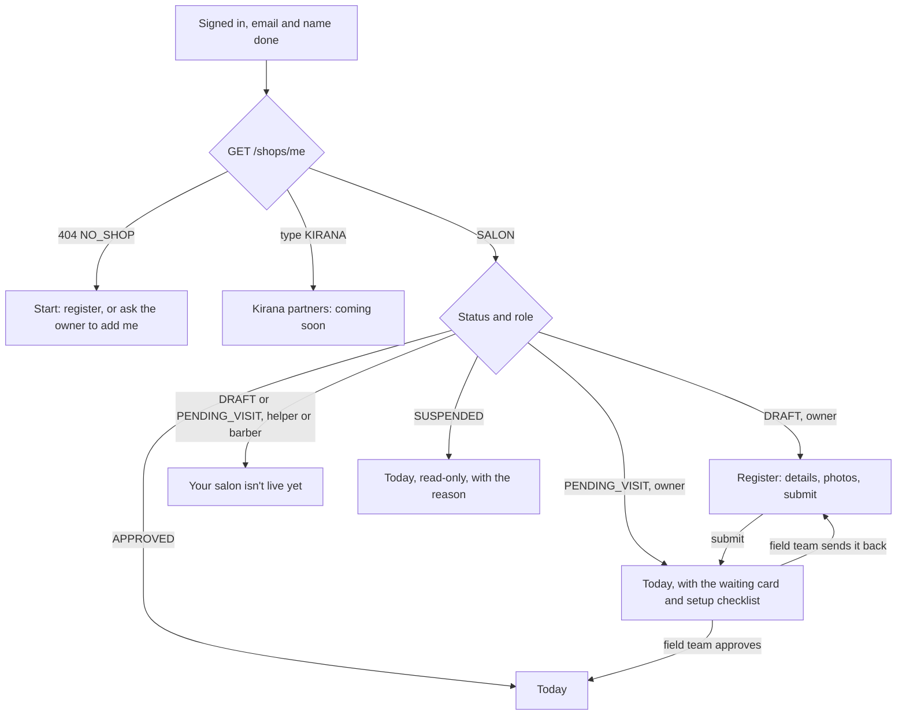
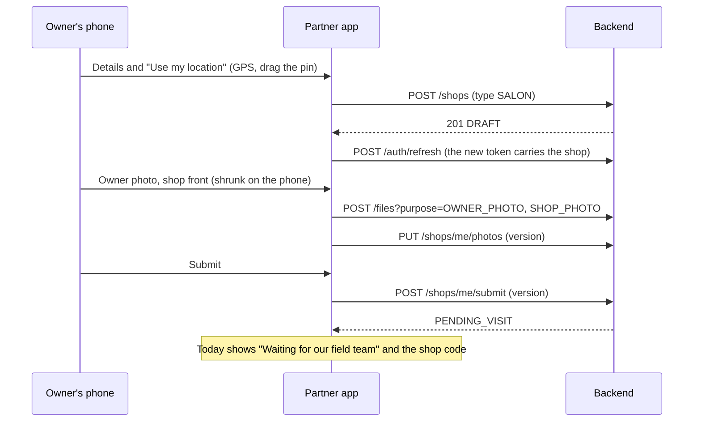
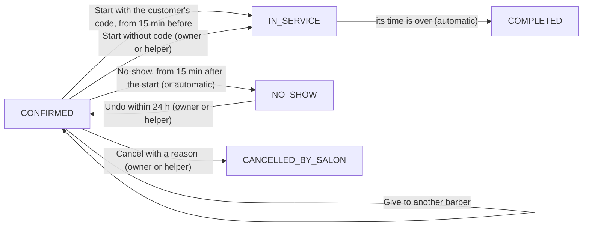

# Apni Dukan — partner app

The app salons use to run their day on Apni Dukan: register the salon, set up services and barbers, and work the
day's bookings and walk-ins. It is a phone-first web app (it can be added to the home screen) and talks only to
[apni-dukan-backend](https://github.com/Premanshu-jha/apni-dukan-backend).

One app for everyone in a salon, each seeing only their part:

| Role | How they get in | What they see |
| --- | --- | --- |
| Owner | Registers the salon here | Everything: setup, the day board, breaks and leave, closed days, pause, Team |
| Helper | The owner adds their number in Team | The day board and its actions, breaks, pause; setup to look at, not change |
| Barber | The owner gives him a sign-in on his barber page | His own bookings and his own breaks (everyone's day if the owner gave him walk-in access) |

v1 is for salons only. Someone whose shop is a kirana sees "Kirana partners: coming soon" and nothing else; no
kirana screen exists in this app. Customers use [apni-dukan-customer](https://github.com/Premanshu-jha/apni-dukan-customer);
the field team (approvals, strike support) will use the admin app.

## Run it on your laptop

You need Node 22 and the backend running (on your laptop at `http://localhost:8080`, or on Railway).

```bash
npm install
cp .env.example .env.local     # then edit the values
npm run dev                    # http://localhost:5174 (5173 is the customer app)
```

| Setting | What it is | Example |
| --- | --- | --- |
| `VITE_API_URL` | The backend's address, no trailing slash | `http://localhost:8080` or `https://apni-dukan-backend-production.up.railway.app` |
| `VITE_TURNSTILE_SITE_KEY` | Cloudflare Turnstile **site** key (public). Leave empty when the backend has no `TURNSTILE_SECRET_KEY` | `0x4AAAAAAA…` |
| `VITE_SUPPORT_EMAIL` | Where partners write for help (More). Default `support@apnidukan.in` | `support@apnidukan.in` |
| `VITE_MAP_TILES` | Map tiles for the location pin. Default OpenStreetMap's, fine for low traffic (see its tile policy) | empty |

All are public values baked into the page at build time. No secret ever goes in this app.

The backend must allow this app's address in `CORS_ALLOWED_ORIGINS`: add `http://localhost:5174` for local work,
and the deployed address once it is online.

| Command | Does |
| --- | --- |
| `npm run dev` | Dev server with hot reload |
| `npm run typecheck` | TypeScript check |
| `npm run lint` | oxlint |
| `npm test` | Unit tests (Vitest) |
| `npm run e2e` | End-to-end tests (Playwright): a real browser drives the app against a fake backend |
| `npm run build` | Type-check and production build into `dist/` |

CI runs type-check, lint, unit tests, build, the end-to-end tests and a gitleaks secret scan on every pull request.

### Tests

Every situation an owner, helper or barber can run into is listed in [`docs/scenarios.md`](docs/scenarios.md): the
journey, what the backend answers, what the screen shows, and which test proves it. New work adds or updates rows
there, and reviews walk the list against the code.

- **Unit tests** (`src/**/*.test.ts`): role rules, the token's shop, registration checks, rupees to paise, weekly
  hours, break and leave times in India time, pause ends, grouping by date, which message links may open, photo
  sizes, plus the copied API client, session and India-time tests.
- **End-to-end tests** (`e2e/`): Playwright on a phone-sized Chromium, against `e2e/mockApi.ts`, a fake backend whose
  answers follow the backend's records, rules and error codes (who may do what, versions, the start window,
  conflicts). `.env.e2e` points the app and the map tiles at it, so tests never reach the internet. Journeys:
  registration end to end, a sent-back draft, a blocked location, the gate for every shop state and role, starting
  with and without the code, no-show and undo, reassign, salon cancel, walk-ins (double tap, busy barber, no
  access), breaks with bookings in the way, leave, closed days, pause, setup with stale saves, Team, messages,
  leaving, sign-out, and an expired session in two tabs. A failed run in CI keeps its traces.

## Screens

| Screen | Address | Who |
| --- | --- | --- |
| Sign in, code, email, name | `/signin`, `/signin/code`, `/welcome/*` | Everyone (same as the customer app) |
| Start (no shop yet) | `/start` | New people |
| Register: details, photos, submit | `/register`, `/register/photos`, `/register/review` | Owner of a draft |
| Today (the day board) | `/salon/day?date=` | Everyone |
| New walk-in | `/salon/walk-in` | Owner; others with walk-in access |
| Add a break or leave | `/salon/time-off` | Breaks: everyone (a barber for himself); leave: owner |
| Bookings: coming up, history | `/salon/bookings` | Everyone; history for owner and helper |
| Salon: services, barbers, booking rules | `/setup`, `/setup/*` | Owner edits; helper looks |
| Team | `/team` | Owner |
| Closed days | `/salon/closures` | Owner |
| More (profile, help, sign out, leave) | `/more` | Everyone |
| Messages | `/notifications` | Everyone |

## Flows

### Who sees what after sign-in



### Registering a salon



### A booking on the board



A walk-in is added straight into IN_SERVICE (it starts now). Breaks, leave and closed days are blocks on a
barber's day; the backend refuses them while a booking is in the way, so the app lists those bookings first.

## How it works

### Folders

```
src/
  api/        client (shared with the customer app), shop.ts (shop gate, registration, files), salon.ts (setup and
              the day), notifications, push, types matching the backend's records
  app/        routes, guards (signed in, past registration, role), the shell with the role's tabs
  components/ ui kit, code input, Turnstile, photo picker, pin map (Leaflet, loaded only on registration),
              location guide
  features/   auth, shop (gate, start, register, home), day (board, sheet, walk-in, time off, closed days,
              pause, bookings), setup (services, barbers, rules), team, notifications, profile (More)
  lib/        India time, money, phone, roles, GPS, photo shrinking, storage, device name
e2e/          fake backend and journeys
docs/         scenarios.md
```

### The shop gate

`ShopGate` loads `GET /shops/me` once (re-read when the app comes back into view, every 30 s at most) and gives
the shop to every screen through `ShopContext`. `Home` sends each state and role to its first screen (the first
flow above); `PastRegistration` keeps board screens closed until the salon is submitted (owner) or approved
(others); `RoleOnly` keeps a role out of screens it can't use. The backend checks the same rules and has the final
say (`OWNER_ONLY`, `WALK_INS_NOT_ALLOWED`, `NOT_ALLOWED`).

### Files and the token

The backend's file uploads use the shop named in the sign-in token, and a token gets its shop when it is made. So
the app refreshes the session right after registering (as the backend asks), and `ensureShopInToken` refreshes
before any upload whose token has no shop claim yet (someone added to a shop while signed in).

### The day board

`GET /salon/day?date=` every 30 seconds, on focus and on push. A failed refresh keeps what was showing, with a
note. The day also says which barber profile is the caller's (`myStaffId`): a barber acts only on his own column
(even when walk-in access shows him everyone), and his "Add break" is always for himself. Every action in the appointment sheet locks its buttons while it runs and reloads the day afterwards,
whatever the answer, because a refusal usually means someone else (the customer, another staff member) changed it
first. If a refresh no longer has the open appointment on that day (the customer moved it), the sheet stays and
says so. The board's "today" and the no-show time move on by themselves while the screen is open.

Walk-ins carry an `Idempotency-Key`, one per walk-in: the same key on a retry gives back the same walk-in, and a
new key is made when the services or the barber change.

### Bookings: pages, refreshes and long lists

The coming-up list and the history come 100 at a time (the backend's keyset pages): "Show more" asks for everything
after the last booking shown, sending its `startsAt` and `id` (the history: the answer's `next`) back exactly as
received. A short page is the last; when exactly 100 were left, one more (empty) page ends the list. A failed page or
a tap while offline keeps the list and says so; focus moves to the first new booking (or to the count when a page
brought nothing) and the button stays focusable while loading (`aria-busy`). The history's totals cover the whole
range on every page, so they come from the first page.

Refreshing a paged list (every 60 s for coming up, and on return to the app) asks every loaded page again, one after
the other, so the pages stay joined with nothing missing or twice. The cost stays small: each page has its own ETag,
so an unchanged page is a 304 after one primary-key read on the backend; and at most 5 pages (500 bookings) are
loaded for coming up and 10 (1,000) for the history, after which the screen says where to look instead (a day on
Today, or fewer days) — only when something really comes after: coming up asks the page after the cap once to know
(exactly 500 left: no note), the history has its `next`. We did not use TanStack's `maxPages`: it drops the first (soonest) page from the top and the
backend has no "page before" to bring it back. Refreshing only the first page would leave a gap or a repeat at its
end whenever a booking is added or ends.

Cards are drawn only near the screen (CSS `content-visibility: auto` on each card): with up to 1,000 cards the
browser skips laying out and painting the ones far away, but they stay in the page, so find-in-page, focus and
screen readers reach all of them, and nothing needs measuring. A windowing library would keep fewer elements, but
breaks those and needs fixed heights; at these sizes `content-visibility` is enough on a phone (where it isn't
supported, the list is simply drawn in full).

The inbox loads at most 10 pages of 30 (300 messages) for the same reason: a refresh after marking read asks every
loaded page again.

### Shared phones

When a session ends (sign-out here, sign-out or someone else's sign-in in another tab, or the backend refusing a
refresh), `forgetThisPerson` clears the cached data, where they were going, an unsaved registration (which is also
tagged with who typed it) and the notifications still in the tray.

### Times

Every date and time is India time (`lib/ist.ts`), whatever zone the phone is set to. Leave covers whole India days:
the first day's 00:00 to the 00:00 after the last day.

### Notifications

The inbox asks for `app=partner` (salon and shop messages only). Push is per person, not per app, so someone who
is also a customer can get a customer message on this phone: the service worker opens only this app's pages
(`/salon/*`, and `/shops/*` as the start) and otherwise the board.

### Copied from the customer app

Since 0.3.0 the client also keeps the last answer to each read in memory (per person, at most 200 addresses, forgotten
on sign-out) and sends its ETag back as `If-None-Match`: the day board (every 30 s) and the coming-up list (every
60 s) carry the backend's own tag (`"s1-…"`, from the salon's change counter) and an unchanged one is a 304 with no
body. The tag is opaque to the app.

`src/api/client.ts`, `errors.ts`, `auth.ts`, `push.ts`, `src/store/session.ts`, `src/lib/{ist,money,phone,storage,device}.ts`,
`src/components/{ui,CodeInput,Turnstile}.tsx` and `src/features/auth/*` are copies of the customer app's, with
the storage keys renamed (`adp.*`) and the wording changed for partners. A fix in one should go to the other until
the admin app makes a shared package worth it.

## Deploying

Any static host works (Railway, Vercel or Cloudflare Pages). Build command `npm run build`, output folder `dist`,
and set `VITE_API_URL` (and `VITE_TURNSTILE_SITE_KEY` in production). All routes must serve `index.html`
(`public/_redirects` does this where supported). Then add the site's address to the backend's `CORS_ALLOWED_ORIGINS`.

Until the admin app exists, nobody can approve a salon: for a first real test, approve it by hand in the database
(set `shops.status` to `APPROVED`).

## Changelog

### 0.4.0 — 2026-11-06

Uses the backend's scale PR (apni-dukan-backend#33, "Pages (the exact contract)"; merge that first):

- Bookings: coming up and the history come 100 at a time with "Show more" (keyset cursor from the last booking, or
  the history's `next`). A failed page or an offline tap keeps the list and says so; focus moves to the first new
  booking (or to the count); `aria-busy` while loading. The history's "pick fewer days" note is gone (paging
  instead); its totals come from the first page and cover the whole range.
- Refreshes ask only the loaded pages again, at most 5 (coming up) or 10 (history); see "Bookings: pages,
  refreshes and long lists". The note at the cap shows only when more really comes after. Long lists draw only the cards near the screen (`content-visibility`).
- The day board and the coming-up list carry the backend's own ETag (`"s1-…"`); the client's ETag memory (0.3.0)
  treats it as opaque, so an unchanged board or page is a 304.
- Messages: at most 10 pages (300) loaded, then "Showing the latest 300 messages."
- A failed read is retried after the backend's `Retry-After` (503 SERVICE_BUSY: 5 s), not after 1 s.
- Tests: the fake backend pages, orders (to the microsecond), tags and refuses cursors like the real one; end-to-end
  journeys for ties across a page end, exactly 100, a failed and a refused page, offline, focus, refreshes as 304s,
  the cap, the history's `next` and totals, the inbox cap; unit tests of the paging helpers and the retry delay.

### 0.3.0 — 2026-11-06

Needs the backend's scale PR (#31):

- ETags: the API client keeps the last answer to each read in memory only (per person, at most 200 addresses), sends
  its ETag as `If-None-Match` and shows the kept data on a 304, so the day board and the bell, re-read every 30 to 60
  seconds, download nothing when nothing changed. Answers stay `no-store` (a shared phone keeps nothing after
  sign-out); the memory is forgotten on sign-out, when the session ends and when another person signs in. A 304 is
  never an error and never retried.
- A 304 for which nothing is kept (a cache or proxy on the way, or the person signed out or changed while the
  read was on its way) is asked once more without `If-None-Match` and past any cache, instead of becoming an error.
- Photo uploads answered 503 `PHOTOS_BUSY` show "Lots of photos are being sent right now. Try again in a minute."
  under the picker and are not sent again by themselves (only `SERVICE_BUSY` is a short blip worth repeating).
- Tests: the fake backend answers ETags and 304s like the real one; end-to-end tests for a 304 refresh and a busy
  photo upload; unit tests of the ETag memory and of PHOTOS_BUSY not being repeated.

### 0.2.1 — 2026-11-06

- Messages: "99+ unread" on the bell's spoken label and in the inbox once there are more than 99 (the backend now
  counts unread up to 100, so 100 means 100 or more). The fake backend caps the count the same way; an end-to-end
  test covers it.

### 0.2.0 — 2026-11-05

Uses the backend's salon fixes (backend PR "Salon gaps found by the partner app review"; merge that first):

- **Done early** on anything in the chair: the rest of the barber's time is free.
- A walk-in in the chair can be given to another barber (the rest of the visit, from now), or cancelled as a mistake
  in its first 15 minutes in a chair (counted from when it was put in one, so a move doesn't reset it), by the owner,
  a helper or whoever added it (who may also mark it done early).
- A barber's own column comes from the backend (`myStaffId`): a barber with walk-in access sees everyone but acts only
  on his own column, and "Add break" is always his own.
- A barber's own breaks: today or tomorrow, at most 4 hours a day, checked before sending; "Remove break" only on
  breaks he added (`addedByMe`) that haven't started.
- Start shows only from 15 minutes before to 15 after the booking's time ("Start opens at …"), and turns off on the
  code screen if that window closes while it is open; "Undo no-show" only within 24 hours.
- Queries and actions run even when the phone thinks it is offline, so the board says "offline" instead of waiting.
- Refusals use the backend's reasons ("someone changed it meanwhile: it is now …", "given to another barber",
  "busy until…").
- New messages in the inbox: a booking given to another barber, cancelled by the salon, a walk-in cancelled.

### 0.1.0 — 2026-11-05 (first version)

First version, for salons:

- Sign-in, email and name steps, and the session, copied from the customer app (own storage keys).
- Shop gate: start screen for people with no shop, kirana "coming soon", "not live yet" for staff, read-only day for
  a suspended salon.
- Registration in three steps: details with a GPS pin on a draggable map, owner and shop photos shrunk on the
  phone, check and submit; a sent-back draft shows the field team's reason.
- Today: a day board per barber with ‹ › days, the setup checklist, pause and resume, and an appointment sheet to
  start (with or without the code), mark and undo no-shows, give to another barber, cancel with a reason, and call
  late customers (owner and helper).
- Walk-ins, breaks and leave (with bookings in the way listed first), closed days.
- Bookings: coming up, and history with totals for owner and helper.
- Salon setup: services, barbers (services, weekly hours, sign-in, photo) and booking rules.
- Team: helpers and walk-in access. More: profile, notifications, help, sign out, leave the salon.
- Messages inbox for salon and shop news; push opens only this app's pages.
- Unit and end-to-end tests in CI, and the scenario list in `docs/scenarios.md`.
- After the independent reviews: start-code errors as the backend sends them (tries left, lock), field reasons
  spelled out, walk-in keys kept after a lost answer, a failed re-check keeps the screen, every tab forgets the
  previous person, cleared date fields can't crash a screen (plus an error boundary), shifts till midnight, the
  board, no-show time and pause banner move on by themselves, and the end-to-end job pinned to Ubuntu 24.04.
